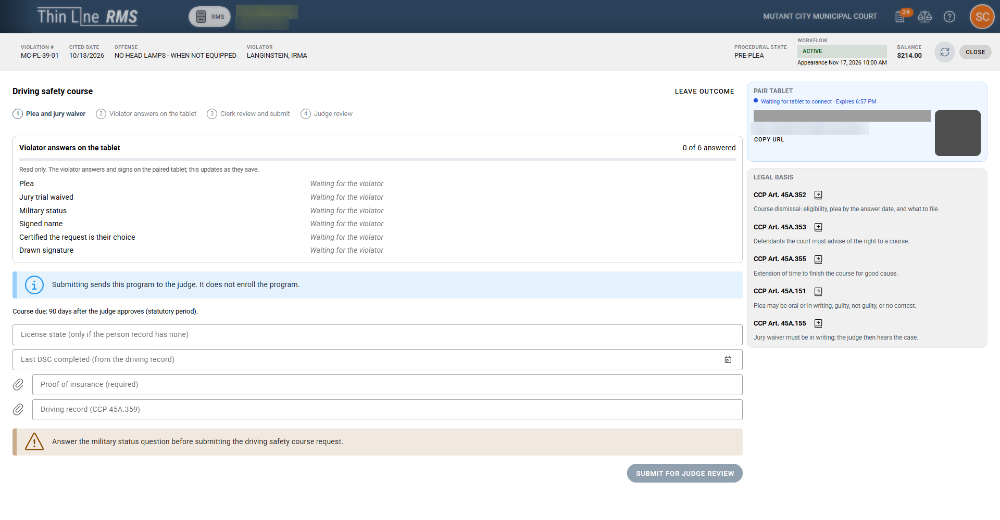
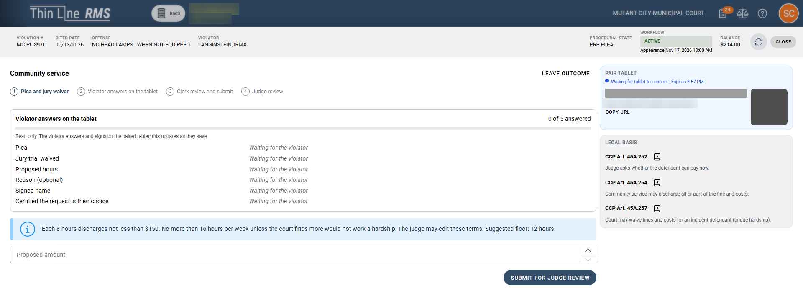
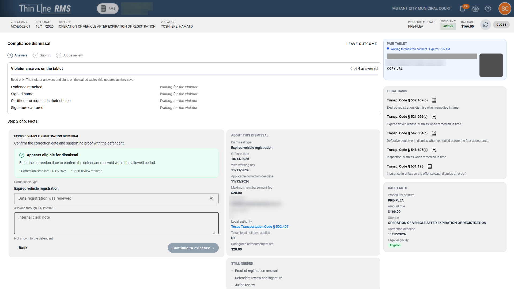
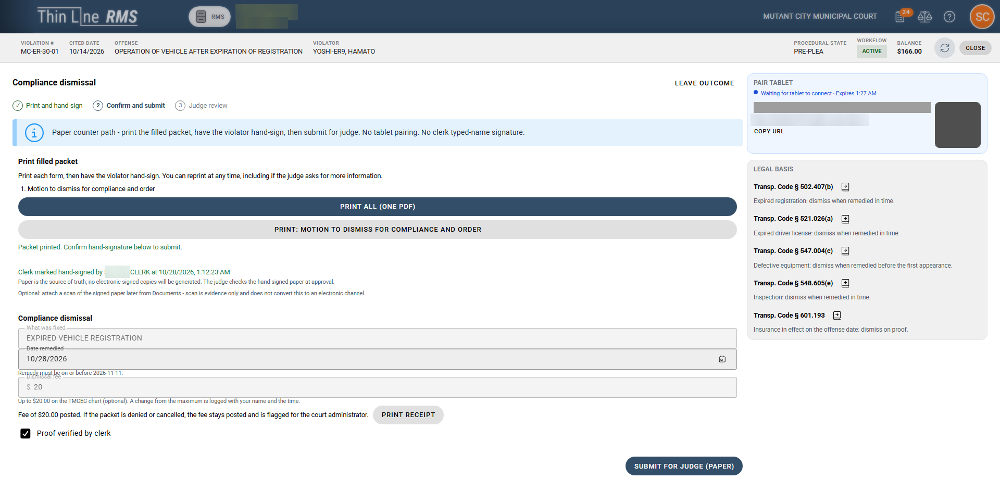
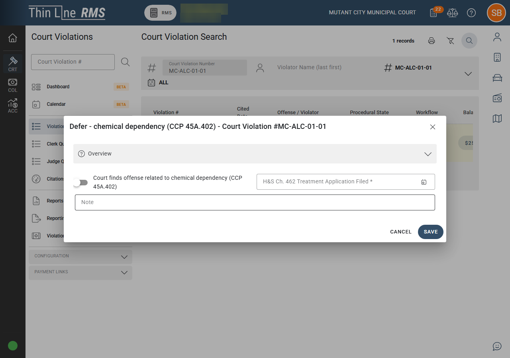

# Court programs and eligibility

> **Not yet approved for demos.** This page describes the current Court V2 build, which is newer than the version approved for demos. Use it for training and planning. Check [Demoable now](demoable-now.md) before showing these screens to a customer.

This page covers driving safety course and deferred disposition eligibility, requests for more time, hardship, community service and payment plans, teen court, Youth Diversion, and the case requests and orders panels. Every program request goes to the judge. Submitting never enrolls the violator; the judge approves, rejects or returns the request with Needs Info.

## Program deadlines

| Program | Period shown |
|---------|--------------|
| **Driving safety course** | **90 days** after the judge approves |
| **Deferred disposition** | **180 days**. A longer period can't be set. |

The deadline is shown read-only to the clerk, on the tablet and on the portal. The agency's default number of days can't be set above these limits.

## Driving safety course and deferred eligibility

Thin Line checks eligibility when the outcome card is shown and again when the request is submitted, using the case as it stands at that moment. The judge's approval checks it once more.

| Situation | Result |
|-----------|--------|
| **Commercial driver license** on the citation | Driving safety course not available. Deferred not available on moving violations. This is a statutory eligibility denial. |
| **Workers present** on the citation | Driving safety course and deferred not available. This is a statutory eligibility denial. |
| **Leaving the scene** (Transportation Code 550.022 or 550.023) | Driving safety course not available. This is a statutory eligibility denial. Deferred may still be offered, at the judge's discretion. |
| **School bus offense** (Transportation Code 545.066) | Driving safety course not available. Deferred may still be offered, at the judge's discretion. |
| **95 mph or more, or 25 mph or more over the limit** (CCP 45A.352(a)(5)) | Driving safety course not available, with no override. Deferred may still be offered, at the judge's discretion. |
| **Offense type missing** | Driving safety course not available, with the reason *Offense type missing*. |
| **Date of birth missing** on a moving violation | Deferred blocked, with the reason *Date of birth required for Deferred on a moving violation*. |
| **Under 25** on a moving violation | Deferred can go ahead, and a driving safety course is added as a condition of the same plan. |

In the Judge Queue, a program request can show a **Statutory notes (informational)** box and the line *Approve re-checks these rules against current case facts.*

## Driving safety course request details

*A driving safety course request at the counter. The violator answers on the tablet while the clerk fills in the rest.*

The request moves through four steps: **Plea and jury waiver**, **Violator answers on the tablet**, **Clerk review and submit**, and **Judge review**. Along with the plea and signature, it collects:

- **Military status** (required).
- **License state**, only when the person record has none.
- **Last driving safety course completed**, from the driving record.
- **Proof of insurance** (required) and the **driving record**.

**Submit for judge review** is blocked until the required answers and documents are in. On paper, the clerk copies the military status from the signed form, and checking **Proof verified by clerk** stands in for an insurance upload.

## More time to finish a driving safety course

Under CCP 45A.355, the judge can give more time to finish a driving safety course for good cause.

- **While the course is active,** the clerk uses the **DSC more time** panel under **Case requests and orders**. The judge sets the new due date.
- **After the violator fails to complete the course,** the clerk uses the **DSC after failure** panel to send the request to the judge or to record the judge's paper ruling. This is allowed until guilt is adjudicated. Only the judge rules on it.
- **Online,** the portal shows *Need more time to finish the driving safety course? You can ask the judge for more time.*

## Request for more time (extension)

A general extension is a **Request for more time** in the workspace. On the portal it's labelled **Request an extension**.

- A case can have only one open extension request.
- The violator can ask for a due date up to 30 days out.
- No evidence is required.
- Each extension is the judge's decision. When approving, the judge sees **Grant the extension** with the requested date filled in and can change it. The new due date must be after today.
- When the judge rules on paper, the clerk records the paper ruling for that judge.
- Deadlines set by statute for a compliance dismissal can't be extended.

*The judge confirms or changes the new due date when approving an extension.*

## Hardship (ability to pay)

Hardship is its own request using the full TMCEC indigent application. The financial disclosure fields are required to submit.

- **On the tablet and online,** the violator must upload at least one piece of evidence.
- **On paper,** the violator signs a sworn financial form, and Thin Line tracks the answers. **Not yet approved for demos:** paper hardship is still being aligned with the evidence step in the current build.

The hardship form's **Community service** and **Extend to a later date** checkboxes only tell the judge what the violator is asking for. They never create a community service order or an extension, and hardship is never a combined request.

## Community service and payment plans

Community service and payment plans can be requested without a hardship request. When the judge approves one, that approval is the ability-to-pay finding.

**Community service:**

- Starts only when the judge approves it. Submitting, rejecting or returning it with Needs Info never starts it.
- The violator proposes hours or an amount. The screen explains the terms: each 8 hours discharges at least $150, and no more than 16 hours a week unless the court finds more wouldn't be a hardship. The judge can edit the terms.
- No evidence is required, and there's no community service fee.
- If there's no judgment on the case yet, approving community service enters a guilty judgment.

*A community service request at the counter, with the terms the judge can edit.*

**Payment plans:** when the judge approves a payment plan, the judgment is signed and then the schedule starts. A standard payment plan the judge has pre-authorized, taken at the counter or on paper, skips the ability-to-pay questions. A claimed inability to pay, or a request for community service, a waiver or a non-standard plan, goes to the judge.

## Compliance dismissal

A compliance dismissal is for offenses the law lets the court dismiss once the violator fixes the problem, such as an expired registration or license, defective equipment, an inspection, or insurance in effect on the offense date. It's a **Pre-plea** outcome card when the offense qualifies. The judge signs every dismissal.

*The clerk records what was fixed and when, and the legal basis is shown alongside.*

- **Fee.** The dismissal fee follows the TMCEC chart and is "not to exceed" the chart amount. It defaults to the maximum. A lower amount is logged with the clerk's name and the time. The fee is collected at the counter before the judge rules.
- **Paper.** The clerk prints the packet (**Print all (one PDF)** or each form), the violator hand-signs, and the clerk confirms the hand signature. Checking **Proof verified by clerk** records that the clerk saw the proof. Attaching a scan of the signed paper later is optional and is evidence only. The signed paper goes in the physical packet.
- **Submit.** The clerk uses **Submit for judge (paper)** or, on the tablet path, **Submit for judge review**.
- **Needs Info** keeps the fee paid.
- **Denied or cancelled.** The fee stays posted and is flagged for the court administrator, and a follow-up appears in the Clerk Queue. There's no automatic refund.
- **Already paid.** Cash paid earlier beyond what's owed is flagged as a refund due. A compliance dismissal is blocked when a payment has already been entered as a plea and judgment.
- A judge can also dismiss a compliance case directly.

*The paper path: print, hand-sign, confirm, check Proof verified by clerk, then submit for the judge.*

## Teen court

On paper or the tablet, teen court takes only the request and the fee. It then sets an open-court hearing with a parent present (CCP 45A.401).

## Youth Diversion

Youth Diversion is for children ages 10 to 16 on non-traffic, fine-only offenses. It's handled at the counter or on paper only, never online. On the portal, the violator is told: *Juvenile combined is not available online. Complete at counter.*

*A case for a child under 17: the parent presence panel, dismissal panels and Record youth diversion decision.*

| Area | How it works |
|------|--------------|
| **Parent or guardian** | Before any plea, the clerk records the parent or guardian present (CCP 45.0215). A parent or guardian signs next to the child, on the tablet or on paper. |
| **Conditions** | The clerk or paper form selects the conditions, such as community service, tobacco awareness or an alcohol class. |
| **Prosecutor objection** | Youth Diversion isn't granted when the prosecutor objects (CCP 45A.504(d)). The prosecutor objects in the Prosecutor Queue, or the clerk records a paper objection. |
| **Youth Diversion decision** | A clerk or a judge records the decision with **Record youth diversion decision**: declined, or not eligible (CCP 45A.504(b)). It's recorded on the case timeline. A prosecutor can't record it. |
| **Hearing orders** | Only a judge enters hearing orders, with a drawn signature. |
| **Confidentiality** | Youth Diversion records are visible to court staff only. Public lookup and payment pages don't show them. |

Youth Diversion and juvenile deferred disposition are separate outcomes. Driving safety course plans never apply to Youth Diversion.

## Case requests and orders

These panels appear in the middle column of the clerk workspace when the case state allows them.

| Panel | Who | Purpose |
|-------|-----|---------|
| **Parent presence before plea** | Clerk | CCP 45.0215: records the parent or guardian present before a minor's plea. Online and mail pleas and payments aren't available when it's required. |
| **Parent nonattendance dismissal** | Clerk starts, judge signs | CCP 45A.403: dismissal for a parent's part in a child's nonattendance. The school's proof is a clerk check on paper. |
| **DSC more time** and **DSC after failure** | Clerk starts, judge rules | See [More time to finish a driving safety course](#more-time-to-finish-a-driving-safety-course). |
| **Ability to pay inquiry** | Judge | CCP 45A.252 and 45A.253: the judge records the ability-to-pay answer before judgment. A plea change to guilty or no contest at trial needs this first. |
| **Fine or cost waiver** | Judge | Needs a judgment on the case. |
| **Commitment discharge** | Clerk records, judge sets terms | Records a commitment discharge. |

**Chemical dependency deferral** (CCP 45A.402) is on the case action menu for eligible cases.

*Eligible cases can open chemical dependency deferral from the case action menu.*

## Related

- [Portal and online options](portal-and-online-options.md)
- [Compliance gaps](compliance-gaps.md)
- [Path walk](path-walk.md)
