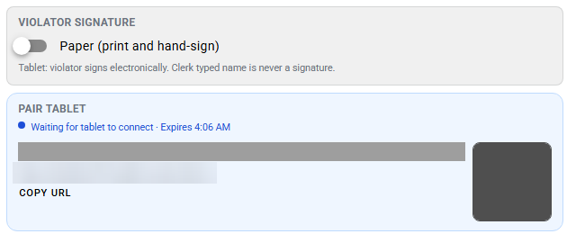

# Demoable now

This page lists what you may show customers in a Court V2 demo today. It covers the version approved for demos, which is not a go-live date or a promise about production rollout.

Anything not on this list, including everything on pages marked **Not yet approved for demos**, stays out of customer demos until this page says otherwise.

## Approved for demos

*Officers record the oath, probable cause and court attachments on the citation before it reaches court.*

*The clerk pairs a counter tablet from the workspace.*

*Once paired, the workspace shows Tablet connected and the violator continues on the tablet.*

| Feature | What to show |
|---------|--------------|
| **Outcome requests** | The violator or a clerk picks an outcome (for example pay in full, payment plan, driving safety course, deferred disposition or compliance dismissal). The request goes to the judge for a decision. Compliance dismissal follows the TMCEC chart, and the judge signs every dismissal. |
| **Officer issuance with probable cause** | Oath, probable cause narrative, offense catalog and court attachments on the citation. |
| **Clerk and counter tablet** | The clerk pairs a counter tablet from the workspace, the tablet shows **Tablet connected**, and the violator reviews and signs on the tablet. |
| **Reading the probable cause record** | The clerk or judge reads the probable cause record before later court work. |
| **FTA and CPF warrants** | The judge issues FTA and CPF warrants. The portal never issues warrants. |
| **Portal notices** | The violator reads an FTA notice or CPF show cause notice online and acknowledges receipt. The acknowledgment is time-stamped. There's no upload. |
| **Hardship (ability to pay)** | A standalone hardship request. Evidence is required to submit. The judge approves, rejects or returns it with Needs Info. Hardship with a payment plan is approved for demos. |
| **Extension (request for more time)** | A standalone request for more time. Each extension needs the judge's approval. Extension with a payment plan is approved for demos. |
| **Community service** | A standalone community service request. Submitting doesn't start community service; it starts only when the judge approves it. Rejecting or returning it with Needs Info never starts it. There's no community service fee and no evidence requirement. Community service with a payment plan is approved for demos. |

### Rules that apply to every request

- **One open request per case.** The judge must decide the open request, or the clerk must cancel it, before another one starts.
- **Only the judge approves, rejects or returns a program or relief request.** Violators can't approve their own requests online, and clerks can't approve them at the counter.
- **Submitting isn't approval.** A submitted request waits for the judge. Nothing changes on the case until the judge acts.

### Known gaps (not shipped)

Don't show these combinations as working:

| Combination | Status |
|-------------|--------|
| Extension and community service | Known gap, not shipped |
| Hardship and community service | Known gap, not shipped |
| Hardship and pay in full | Known gap, not shipped |
| Extension and hardship | Known gap, not shipped |

The hardship form has **Community service** and **Extend to a later date** checkboxes. They only tell the judge what the violator is asking for. Checking them never creates a community service order or an extension, and never turns hardship into a combined request.

## Not yet approved for demos

The current Court V2 build is newer than the version approved for demos. These pages describe it for training and planning:

- [Clerk workspace](resolution-workspace-and-controls.md)
- [Portal and online options](portal-and-online-options.md)
- [Court programs and eligibility](court-programs-eligibility.md)
- [Compliance gaps](compliance-gaps.md)
- [Court V2 training](training/README.md)

Don't show those screens to a customer until they're added to the approved list above.

## Out of scope for demos

- **Offense catalog codes.** Only show offense catalog entries your agency has confirmed. Don't present fee codes as live unless the agency has confirmed them.
- **Running Court V1 and Court V2 side by side.** You may compare the two in a local demo environment. That isn't how a court runs in production: once a court turns on Court V2, it stays on. Don't promise a cutover date or a migration plan.

## Reviewers

- **Court BA:** product accuracy on this page.
- **Sales:** what's approved for demos before any customer demo.
