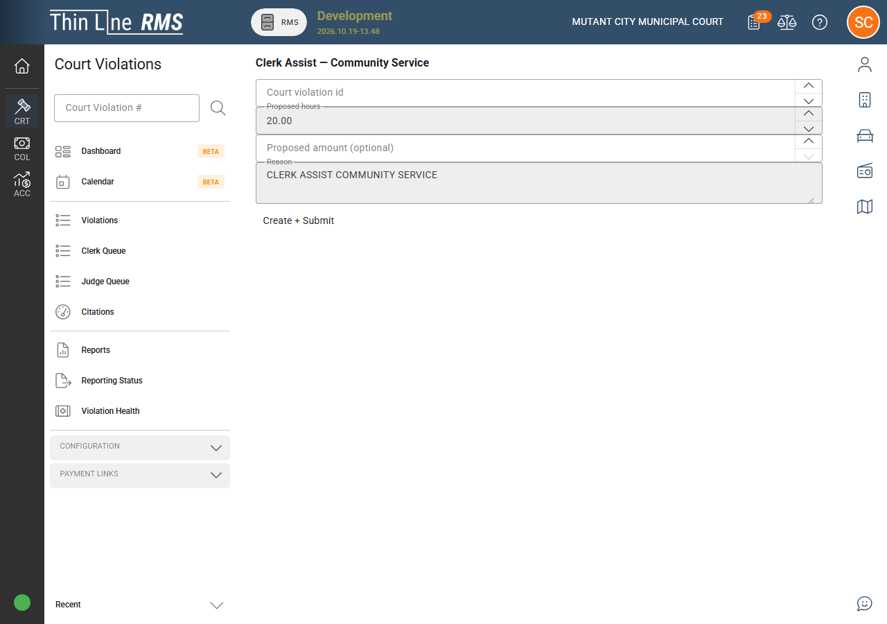
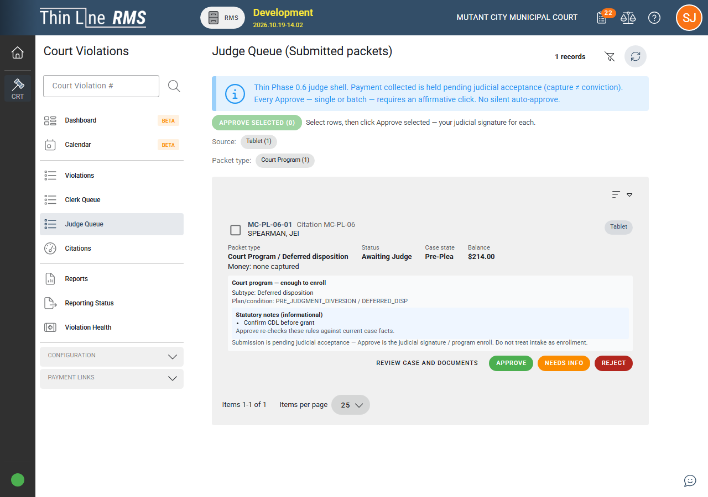

# Court V2 path walk

Customer-facing walk of the **current V2 demo ceiling** in demo order. For what Sales may claim in the room, see [Demoable now](demoable-now.md). For how this relates to V1 guides, see [V1 vs V2](v1-vs-v2.md).

This walk assumes an authenticated defendant on the **online portal** or a clerk on **Clerk Assist** for packet assembly, and a judge on the **staff** queue for outcomes. Packet types share one spine: submit captures defendant intent (and payment capture where Phase 1 paid types apply); **Approve / Reject / NeedsInfo** are **judge-only** (staff APIs — not defendant self-service).

## 1. Typed dispositions (Phase 1)

Defendant or clerk assist starts a **typed disposition packet** (for example pay in full, payment plan, compliance dismissal, plea, or court program — per agency configuration and the locked Phase 1 set).

- Dual channel: **portal** and **in-person tablet / Clerk Assist** on the same backend.
- **One active packet** at a time for the spine rules in effect on your build.
- Paid Phase 1 types: capture at submit; refund on reject — per locked Phase 1 money rules. Do not reopen compliance-dismissal hard-cut or rule-pack pitch in customer conversations.

*Defendants or clerks start typed disposition packets from portal outcome cards or the in-person outcomes hub.*

## 2. Issuance PC cite (Phase 2)

On the law-enforcement / issuance side, the citation carries **issuance quality**: oath record, catalog-driven PC narrative, and **court-record attachments** on the violation (PDFs and similar — not a print-queue product story).

Issuing officer corrections use **addendum-only** behavior; clerks and judges **read** the package later in court flow.

At the [current demo ceiling](demoable-now.md), **Issuance PC cite** is on pitch together with **clerk ↔ tablet** counter flow.

*Officers build probable-cause and catalog quality on the Issuance PC workflow before the case reaches court.*

## 2b. Clerk ↔ tablet handshake

For in-person counter work, clerk pairs a tablet through **`/public/counter-device`** until the UI shows **Tablet connected**, then continues packet assist on the shared V2 spine (same types as portal Clerk Assist).

**ON pitch** at the [current demo ceiling](demoable-now.md) — approved for demos (two-browser verify on prior ceiling). See [Demoable now](demoable-now.md) for the full boundary.

*The clerk opens the counter-device page to pair a tablet for in-person packet assist.*

*After pairing, the tablet shows the connected session and case menu for the violator.*

*The clerk workspace confirms **Tablet connected** on the same case.*

## 3. Package read

Clerk or judge opens the **PC package** for read/review before relying on it in downstream judicial steps (including warrant work). This is a read surface — not a new procedural state named “pending judge” on the case.

## 4. FTA and CPF warrants (Phase 3)

On the **staff** side, ordered judge-only paths for **FTA** and **CPF** warrant work. The portal does **not** issue warrants and does not bypass notice or rule-of-hearing gates by itself.

## 5. Portal read and acknowledge (Phase 3.3)

On the **limited defendant portal**, for eligible FTA and CPF surfaces:

- Defendant **reads** notice or show-cause content (and linked attachments when present).
- Defendant **acknowledges receipt** with a durable timestamp.
- **No upload** of response documents on this slice.

Acknowledgment does not by itself pass gates, issue warrants, or unlock CPF without the ordered staff path.

## 6. Hardship / ability-to-pay (Phase 4.1)

Defendant or clerk assist drafts a **hardship** packet.

| Step | Behavior |
|------|----------|
| Draft | Narrative and proposed terms as implemented on your build. |
| Submit | **At least one evidence upload is required** — submit without evidence fails closed. |
| Pending judge | Packet awaits staff review (submitted / pending judge alias). |
| Approve | Judge applies approved terms via the packet spine (no auto-grant on submit). |
| Reject / NeedsInfo | Staff-only; reject does not apply approved terms; needs info allows more evidence and resubmit without treating submit as approve. |

**Payment plan combined** host is approved for demos. **Pay in full combined** is a known gap, not shipped — do not pitch as shipped.

Staff surfaces follow the same dual-channel pattern as other Phase 4 packets (portal + clerk assist + judge queue).

*Hardship packets can be started online when eligibility allows; evidence rules apply at submit.*

## 7. Extension (Phase 4.2)

Defendant or clerk assist drafts an **extension** packet.

| Topic | Locked behavior |
|-------|-----------------|
| Count cap | **None** — a second extension after an approved one is allowed; each still needs judge **Approve**. |
| Max length | Agency setting **`extension.maxDays`**, default **30** calendar days; over-max proposals fail closed. |
| Evidence | **Not required** on extension (unlike hardship). |
| Submit | Does **not** apply a new due date by itself. |
| Approve | Applies proposed due date through the packet spine when proposed; empty proposed delta is a documented no-op (no auto-grant). |
| Reject / NeedsInfo | Do not apply extension dates; needs info allows edit and resubmit. |

**Payment plan combined** approved for demos. **Extension + hardship** combined is a known gap, not shipped.

## 8. Community service (Phase 4.3)

Defendant or clerk assist places **community service** in **draft**, then **submits** for judge review.

| Topic | Locked behavior |
|-------|-----------------|
| Clock / order start | Starts **only** on judge **Approve**, stamped with **`orderStartedAtUtc`** and **`orderStartedByUserId`**. |
| Reject | **Never** starts CS obligation. |
| NeedsInfo | Does **not** start the clock. |
| Submit | Does **not** start the clock (submit ≠ approve). |
| Proposed work | `proposedHours` / `proposedAmount` shape on your build (at least one required when present; validation as implemented). |
| Evidence | **Not required** on CS (unlike hardship). |
| Fee | No invented CS fee in this slice (`FeeAmount` null). |
| Completion hours | **Not** tracked in this slice — do not demo completion-hour ledgers. |
| Combined hosts | **Payment plan + CS** approved for demos. **Extension + CS** and **hardship + CS** are known gaps, not shipped — do not pitch as shipped. |

### Where to open community service

| Role | Route (as implemented) |
|------|-------------------------|
| Defendant portal | `/portal/citations/:citationNumber/community-service` |
| Judge | `/module/court-violation/community-service` |
| Clerk assist | `/module/court-violation/community-service-clerk-assist` |

Judge **Approve**, **Reject**, and **NeedsInfo** are staff-only on the judge queue / panel for this packet type.

*Clerks open community service clerk assist from the module routes listed above.*

*Judges approve, reject, or return **Needs Info** on submitted packets from the Judge Queue.*

## 9. Documented past the demo ceiling (reference only)

After Phase 4 packets, the current Court V2 build adds staff and portal behavior that is **not** on the on-pitch walk at `64c4bd40a0`. See [Demoable now — Documented past the demo ceiling](demoable-now.md#documented-past-the-demo-ceiling-not-yet-approved-for-demos). Reference pages:

| Topic | Where to read |
|-------|----------------|
| **Payment Links** → **Court V2 Online Portal** (`/public/portal`) | [Resolution workspace and controls](resolution-workspace-and-controls.md) |
| Portal **Start or resume** vs **Complete at counter** | [Portal and online options](portal-and-online-options.md) |
| **Driving safety course** / **Deferred disposition** tier-1 denies (CDL, workers present, school bus, leave scene, under-25 DSC condition) | [Court programs and eligibility](court-programs-eligibility.md) |
| **Enter a plea of not guilty** (clerk soft, online, paper) | [Resolution workspace and controls](resolution-workspace-and-controls.md) |
| **Youth diversion** (ages 10–16 non-traffic) | [Court programs and eligibility](court-programs-eligibility.md) |
| **Ask for more time** (DSC extension) | [Court programs and eligibility](court-programs-eligibility.md) |
| Honesty on incomplete statutory coverage | [Compliance gaps](compliance-gaps.md) |

## End of current ceiling

Steps **1–8** match the **on-pitch** list in [Demoable now](demoable-now.md). Step **9** is documentation only — not demo-approved. Production **V1/V2 cutover** is **not** part of this walk — local dual-path remains approved for demos only.
