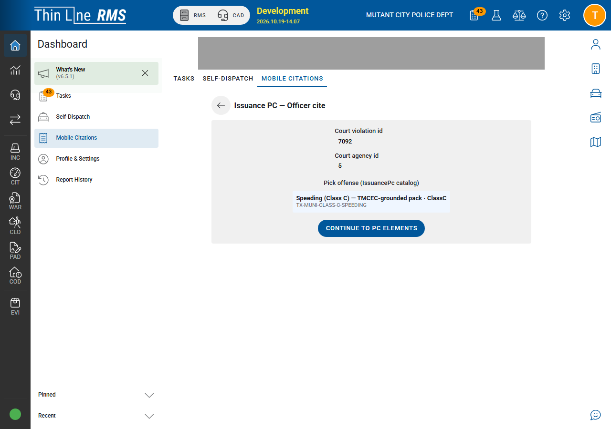
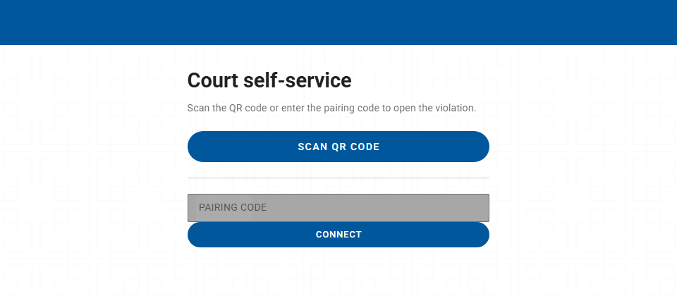
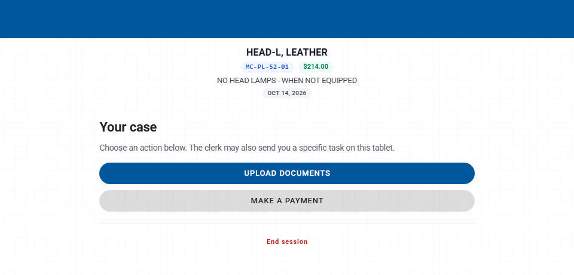
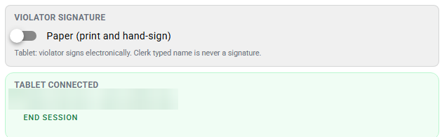
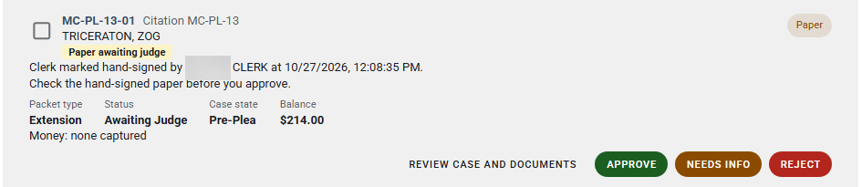

# Court V2 path walk

This is a short tour of how a case moves through Court V2, in the order you'd show it. Steps 1–8 are approved for demos (see [Demoable now](demoable-now.md)). Step 9 lists newer features that are **not yet approved for demos**. For how Court V2 differs from the original Court pages, see [V1 vs V2](v1-vs-v2.md).

Three people take part:

- The **violator** works on the online portal or on a counter tablet, or signs printed paper at the counter.
- The **clerk** works in the case workspace and the Clerk Queue.
- The **judge** approves, rejects or returns requests in the Judge Queue. Only the judge makes those decisions.

## 1. Pick an outcome

The violator, or the clerk helping them, starts an outcome request: for example pay in full, payment plan, driving safety course, deferred disposition or compliance dismissal. Which outcomes are offered depends on the case and on whether the violator is online or at the counter. In person has fewer limits than the portal.

- The portal and the counter tablet use the same requests and the same rules.
- A case can have only one open request at a time.
- When an outcome takes payment, the payment is taken when the request is submitted. If the judge rejects a paid pay in full request, the payment is refunded. A compliance dismissal fee isn't refunded automatically; it's flagged in the Clerk Queue for the court to resolve.

*Violators start an outcome from the cards on the portal. Clerks use the same outcomes in the workspace.*

## 2. Officer issuance with probable cause

On the officer side, the citation carries the oath, a probable cause narrative built from the offense catalog, and court attachments such as PDFs. Corrections after issuance are added as addenda. The clerk and judge read the record later in the court process.

*Officers record probable cause and pick catalog offenses before the case reaches court.*

## 3. Pair a counter tablet

For in-person work, the clerk pairs a counter tablet from the case workspace. When pairing finishes, both screens show **Tablet connected**, and the violator continues on the tablet: reviewing the documents, signing and choosing how to pay.

*The counter tablet waits for the clerk to pair it.*

*After pairing, the tablet shows the connected case.*

*The clerk workspace confirms Tablet connected on the same case.*

## 4. Read the probable cause record

The clerk or judge opens the probable cause record to read it before relying on it for later court work, including warrants. Reading it doesn't change the case.

## 5. FTA and CPF warrants

The judge issues FTA and CPF warrants. The portal never issues warrants, and nothing a violator does online skips the notice or hearing steps.

## 6. Portal notices

When a violator has an FTA notice or a CPF show cause notice, they can read it on the portal, open any attached documents, and acknowledge receipt. The acknowledgment is time-stamped. There's no upload. Acknowledging doesn't issue or clear a warrant; the court still follows its normal steps.

## 7. Hardship, extension and community service

These three requests work the same way: the violator or clerk starts a draft, submits it, and the judge approves, rejects or returns it with Needs Info. Submitting never grants anything.

| Request | What to know |
|---------|--------------|
| **Hardship (ability to pay)** | Uses the full TMCEC indigent application. At least one piece of evidence is required to submit online or on the tablet. When the judge approves, the approved terms apply to the case. |
| **Extension (request for more time)** | The violator asks for a later due date of up to 30 days. No evidence is required. Approving it sets the new due date. After an extension is approved, the violator can ask for another one, and each needs the judge's approval. |
| **Community service** | Community service starts only when the judge approves it. Submitting, rejecting or returning it with Needs Info never starts it. No evidence is required, and there's no community service fee. |

Each of the three can be combined with a payment plan. Other combinations are known gaps (see [Demoable now](demoable-now.md#known-gaps-not-shipped)).

*Violators can start hardship online when the case allows it. Evidence is required to submit.*

## 8. The judge decides

Every submitted request lands in the Judge Queue. The judge reviews the case and documents, then chooses **Approve**, **Needs Info** or **Reject**. Needs Info sends it back to the Clerk Queue with the judge's note. For paper requests, the card shows that the clerk marked the paper hand-signed so the judge can check it before approving.

*A paper extension request waiting for the judge.*

## 9. Newer features (not yet approved for demos)

The current build adds more. These features are documented for training and planning only:

| Feature | Where to read |
|---------|---------------|
| New-case intake, not guilty pleas, Needs Info resubmit and revoking a request | [Clerk workspace](resolution-workspace-and-controls.md) |
| What violators can do online and what they finish at the counter | [Portal and online options](portal-and-online-options.md) |
| Driving safety course and deferred eligibility, program deadlines and more time | [Court programs and eligibility](court-programs-eligibility.md) |
| Youth Diversion (counter or paper only) | [Court programs and eligibility](court-programs-eligibility.md#youth-diversion) |
| Dismissal requests and the Prosecutor Queue | [Court V2 training](training/README.md) |
| What isn't full Texas statutory coverage | [Compliance gaps](compliance-gaps.md) |

## End of the tour

Steps 1–8 match the approved list on [Demoable now](demoable-now.md). Step 9 is for training and planning only.
