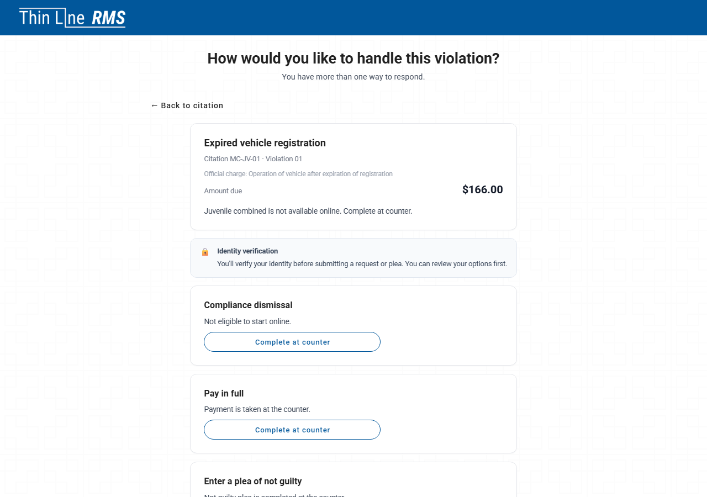

# Portal and online options

> **Past demo ceiling:** This page describes behavior at pushed tip `6234e081ca`, which is **past** the official demo ceiling `64c4bd40a0`. It is **not** approved for demos until Court BA scores that tip PASS and the tls-* Playwright suite is re-run. See [Demoable now](demoable-now.md).

Defendant-facing **Court V2** flows start at **Court V2 Online Portal** (`/public/portal`) after citation lookup, or through links staff open from **Payment Links**.

*Violators enter a citation number and date of birth to open their case in the online portal.*

## Outcome cards on the portal

The portal **resolve** hub shows outcome cards (pay in full, plea, driving safety course, deferred disposition, hardship, extension, community service, compliance dismissal, youth diversion, and related types). Each card has an availability state:

| UI behavior | Meaning |
|-------------|---------|
| **Start or resume** | Online path is available for that outcome. |
| **Complete at counter** | Online or mail path is blocked; staff must help at the counter. The card shows a reason when the rules supply one. |

Family-violence offenses block **Pay in full** and **Plea** online and by mail; those outcomes show **Complete at counter** with family-violence messaging.

*After lookup, the citation dashboard summarizes balance, compliance-dismissal hints, and links into pay or resolve flows.*

*The pay or resolve step routes the violator toward payment or outcome selection.*

*Outcome cards show **Start or resume** or **Complete at counter**, including pay in full, plea, driving safety course, deferred disposition, payment plan, community service, and hardship when rules allow.*

## Driving safety course and deferred disposition (portal)

Program requests use **Driving safety course (DSC)** or **Deferred disposition** labels. The portal shows a **read-only statutory clock** (DSC **90** days; deferred **180** days) and copy that **approval is required before the program becomes active — submission does not enroll the program**.

### Online DSC requests and court authorization

Texas law allows a court to **accept driving safety course requests through the online portal when the court authorizes that channel**. Thin Line exposes portal DSC request fields (military status, required uploads, and related answers) only when the product rules allow the request. **Online DSC is not automatically available** for every agency or offense; denied or counter-only paths show **Complete at counter**.

DSC packet fields include:

| Field | Notes |
|-------|--------|
| **Military status** | Required for DSC requests; helper text explains out-of-state license and active-duty military member, spouse, or dependent child. |
| **Document uploads** | Insurance and other required document types per the DSC packet rules. |

*Some online program and plea paths require identity verification before the violator can continue.*

## Hardship (ability to pay) online

The portal **hardship / ability-to-pay** flow uses the full TMCEC **XIII-B** style application and evidence upload on the V2 path, aligned with clerk/tablet hardship packets.

*The online hardship flow collects the TMCEC-style financial application; sign-in may be required before submit.*

## Not guilty online

When eligible, defendants choose **Enter a plea of not guilty** (subtitle explains guilty/no contest live under other options). Plea type displays as **NOT GUILTY** on the online form.

## Youth diversion on the portal

Youth diversion online follows the same packet spine as clerk assist. Parent/guardian participation is required on tablet and paper channels (see [Court programs and eligibility](court-programs-eligibility.md)).

*For eligible juvenile cases, online outcomes may show **Juvenile combined** and **Complete at counter** when the portal path is blocked.*

## Related

- [Resolution workspace and controls](resolution-workspace-and-controls.md)
- [Court programs and eligibility](court-programs-eligibility.md)
- [Path walk](path-walk.md)
