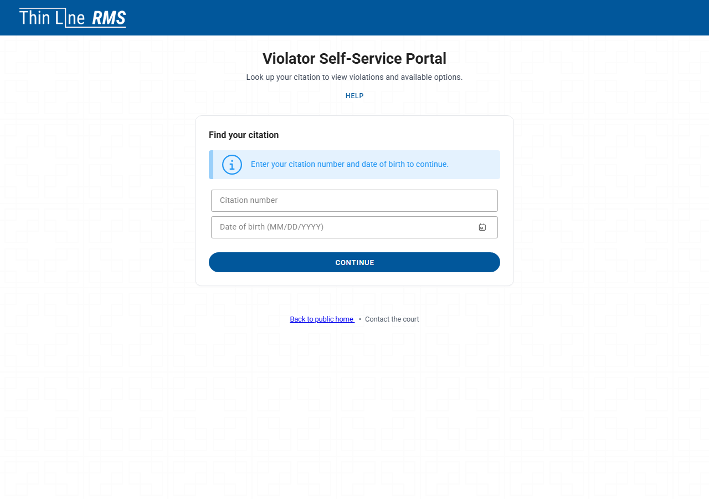
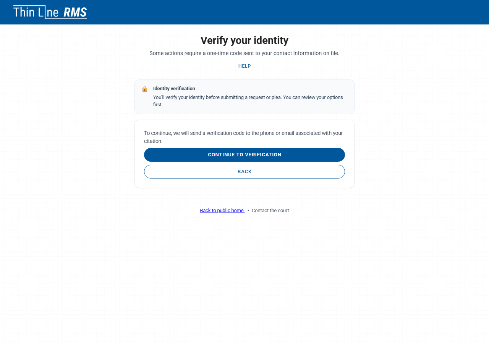
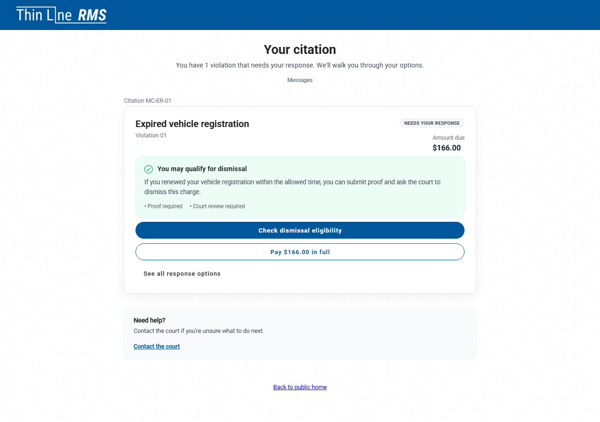
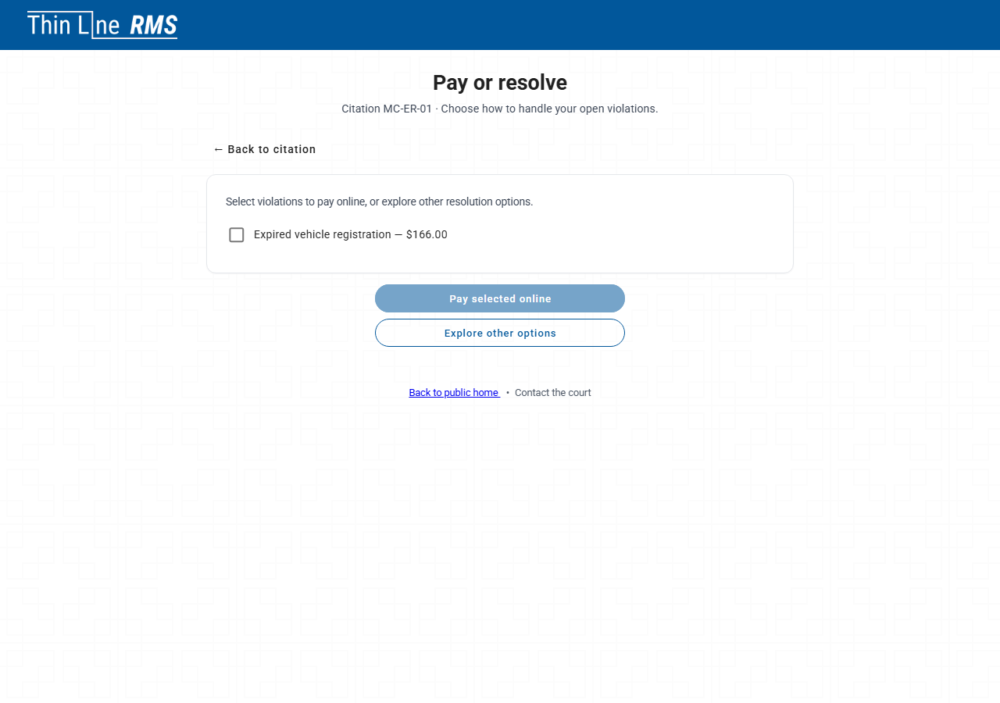
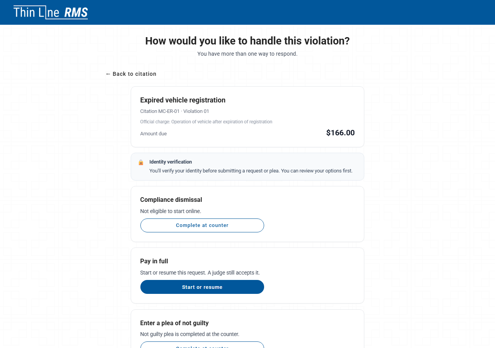
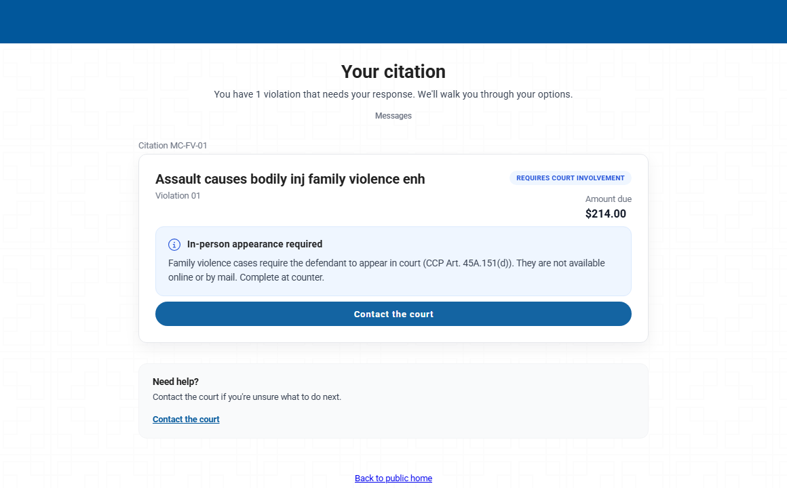
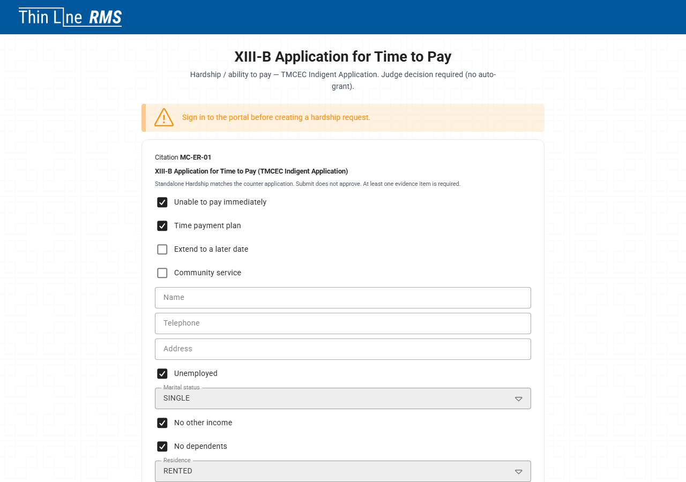
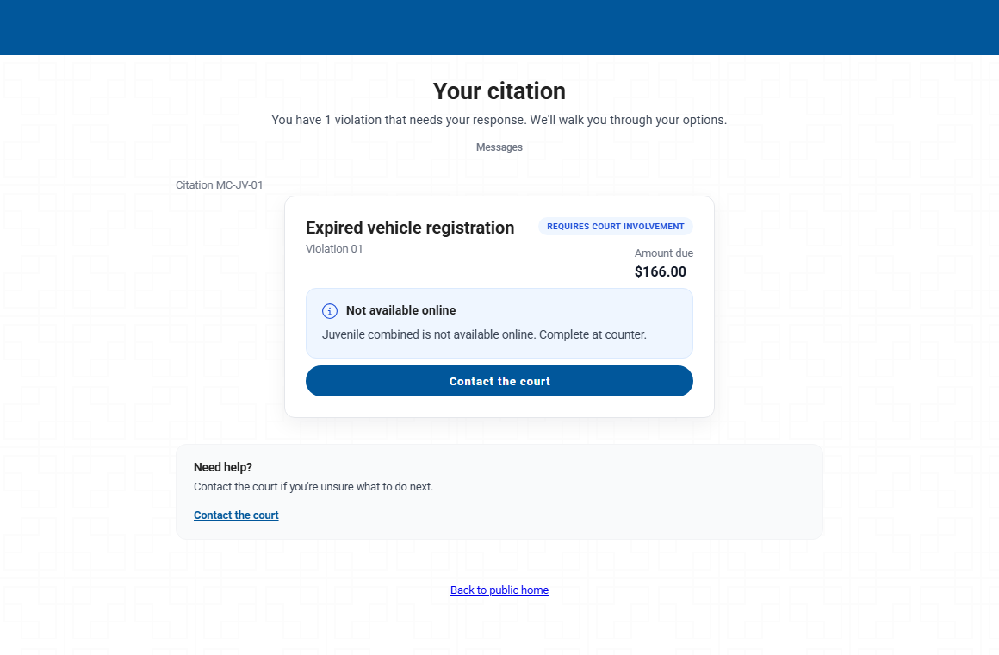

# Portal and online options

> **Not yet approved for demos.** This page describes the current Court V2 build, which is newer than the version approved for demos. Use it for training and planning. Check [Demoable now](demoable-now.md) before showing these screens to a customer.

Violators use the Court V2 online portal to see their case, pay, and request outcomes. Staff can open the same portal from a case through **Payment Links > Court V2 Online Portal**.

The portal has more limits than the counter. When an outcome can't be done online, the portal says so and asks the violator to complete it at the counter.

*Violators enter their citation number and date of birth to open their case.*

## Before the violator can act

- **New cases.** While a case is still new, the portal shows no outcomes. It tells the violator the case is still processing and to check back later.
- **One-time code.** Most online actions ask the violator to confirm a one-time code first. Paying online and exploring options don't.

*The portal asks for a one-time code before most requests.*

## The citation dashboard and outcome cards

After lookup, the citation dashboard shows the balance and links to pay or resolve the case. The resolve page lists outcome cards, such as pay in full, not guilty plea, driving safety course, deferred disposition, payment plan, community service, hardship and compliance dismissal, depending on the case.

| Card shows | Meaning |
|------------|---------|
| **Start or resume** | The violator can do this online. |
| **Complete at counter** | This outcome isn't available online. The violator must come to the counter. The card shows the reason when there is one. |

*The citation dashboard after lookup.*

*The violator chooses to pay or to look at other outcomes.*

*Each outcome card shows Start or resume or Complete at counter.*

### Family violence

For family-violence offenses, pay in full and pleas aren't available online or by mail. Those cards show **Complete at counter** with a family-violence message, and the violator must appear in person. A family-violence not guilty plea is taken at the counter or on paper only.

*On a family-violence case, the portal explains that an in-person appearance is required and sends the violator to the counter.*

## Not guilty online

When the case allows it, the violator can choose **Enter a plea of not guilty**. The portal tells them their submission isn't yet an entered plea. The request goes to the Clerk Queue under **Violator portal**, and the plea is entered only when a clerk approves it. The case then moves to pre-trial.

There's no online guilty or no contest request on its own. A guilty or no contest plea is part of another outcome, such as pay in full, a driving safety course or deferred disposition.

## Driving safety course and deferred disposition

The portal shows the program's deadline as read-only: **90 days** for a driving safety course and **180 days** for deferred disposition. The portal also explains that the judge must approve the request before the program starts. Submitting doesn't enroll the violator.

### Online driving safety course requests

Texas law lets a court accept driving safety course requests through the online portal when the court allows it. Thin Line shows the online request only when the case qualifies. Online driving safety course requests aren't available for every offense, and cases that don't qualify show **Complete at counter**.

| Field | Notes |
|-------|-------|
| **Military status** | Required. Help text explains the out-of-state license and active-duty military member, spouse or dependent child options. |
| **Document uploads** | Proof of insurance and the other documents the request needs. |

## Hardship (ability to pay)

Online hardship uses the full TMCEC indigent application. The violator must upload at least one piece of evidence to submit. The judge approves, rejects or returns the request with Needs Info.

The hardship form includes **Community service** and **Extend to a later date** checkboxes. They only tell the judge what the violator is asking for. They never create a community service order or an extension, and hardship is never a combined request.

*The online hardship application.*

## Youth Diversion isn't offered online

Youth Diversion is handled at the counter or on paper only. On a Youth Diversion case, the portal shows: *Juvenile combined is not available online. Complete at counter.*

*The portal directs Youth Diversion cases to the counter.*

## FTA and CPF notices

When a violator has an FTA notice or a CPF show cause notice, they can read it online, open any attached documents, and acknowledge receipt. The acknowledgment is time-stamped. There's no upload, and acknowledging doesn't clear or issue a warrant.

## What the clerk sees

Portal requests and contact updates appear in the Clerk Queue under **Violator portal**. The clerk opens **Review request** and chooses **Approve** or **Needs info** (and **Deny** where it's offered). See the [Clerk guide](training/clerk-guide.md#violator-portal-requests).

## Related

- [Clerk workspace](resolution-workspace-and-controls.md)
- [Court programs and eligibility](court-programs-eligibility.md)
- [Portal requests scenario](training/scenarios/portal-requests.md)
