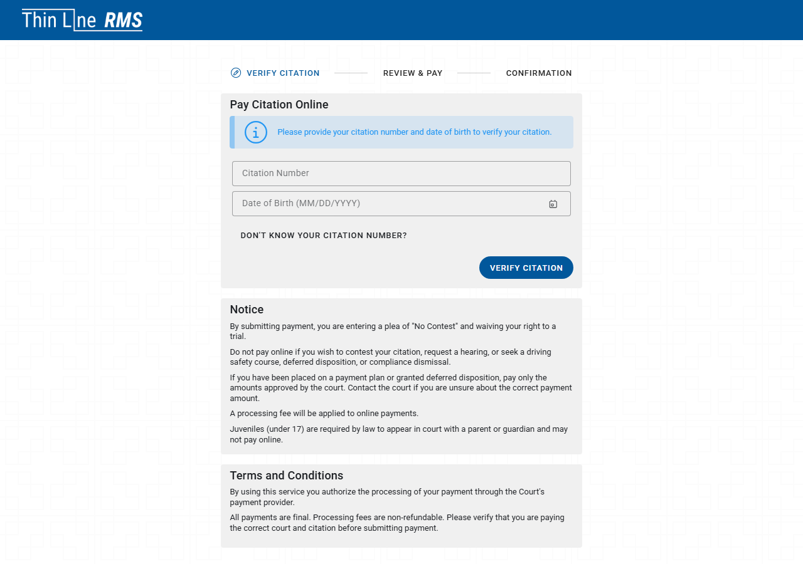
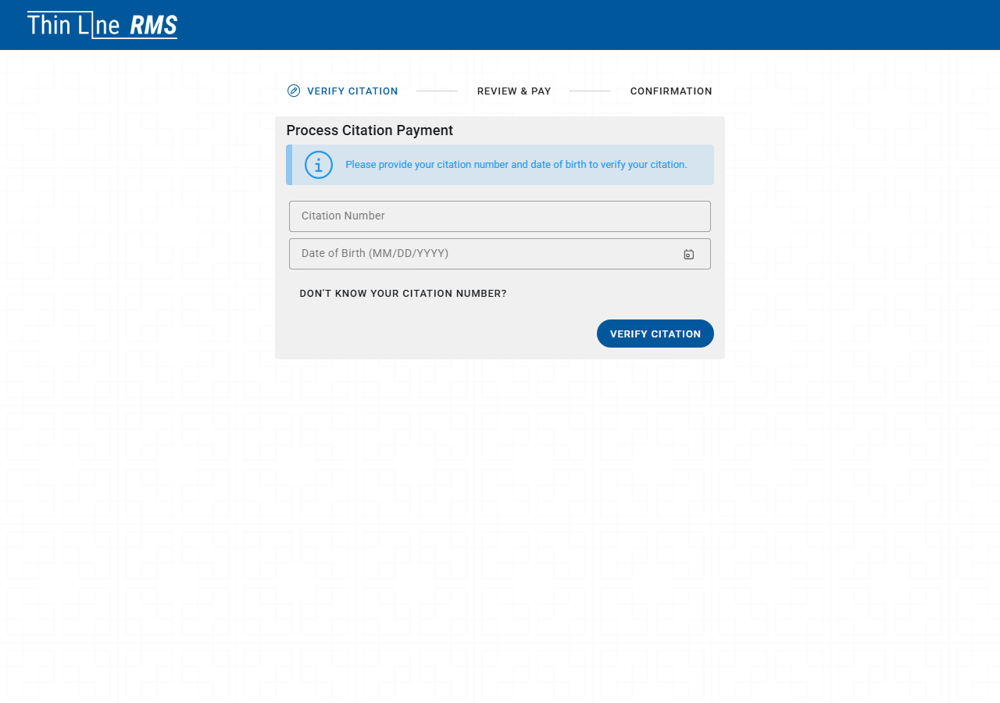
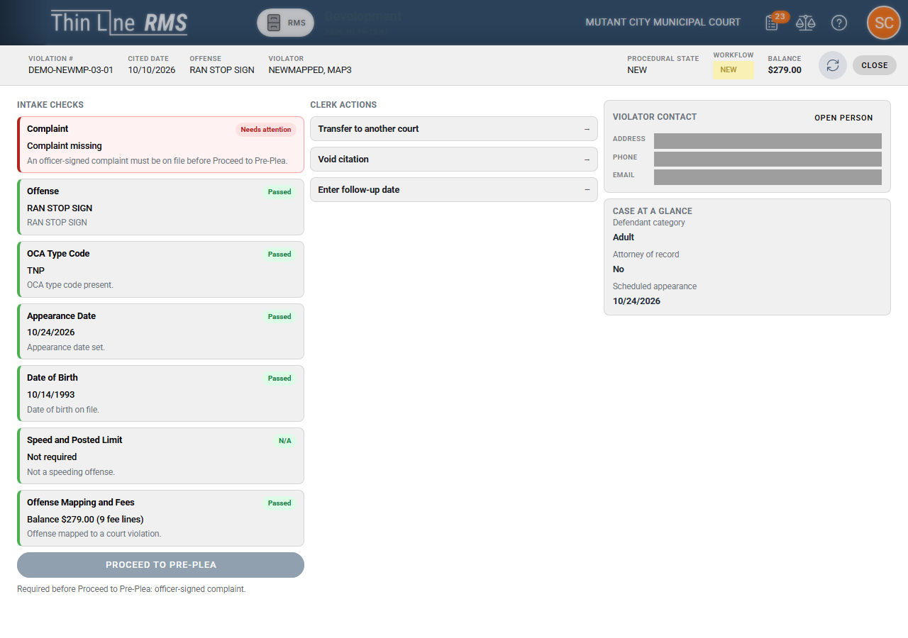
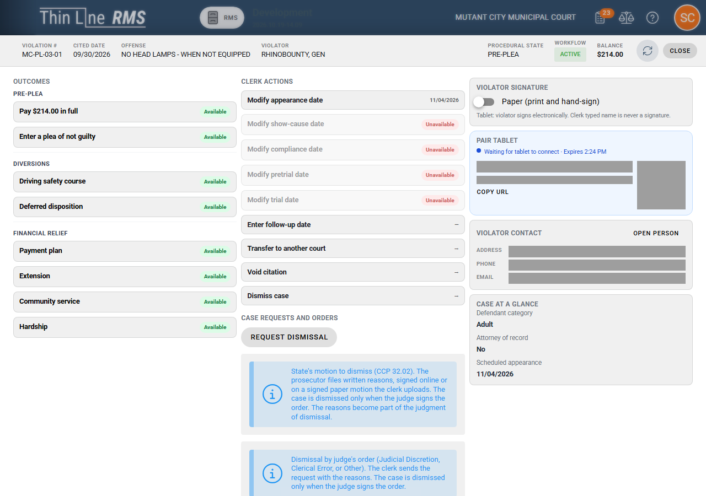
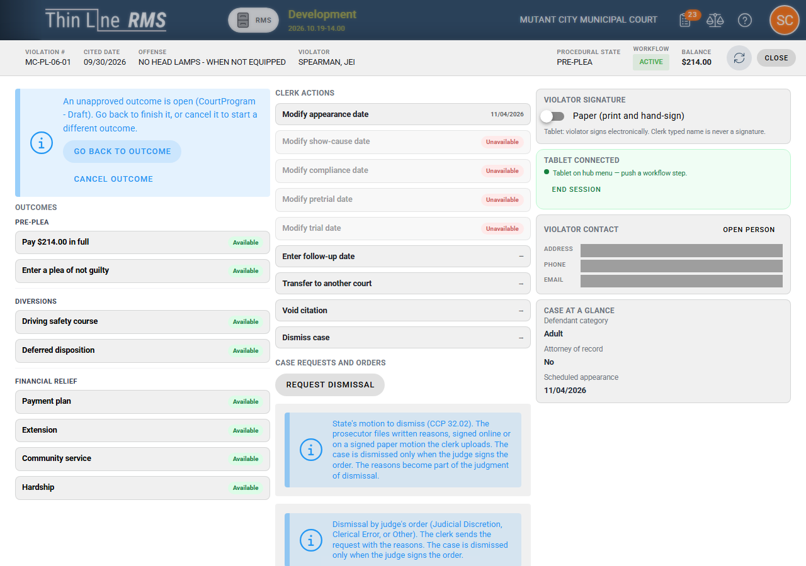
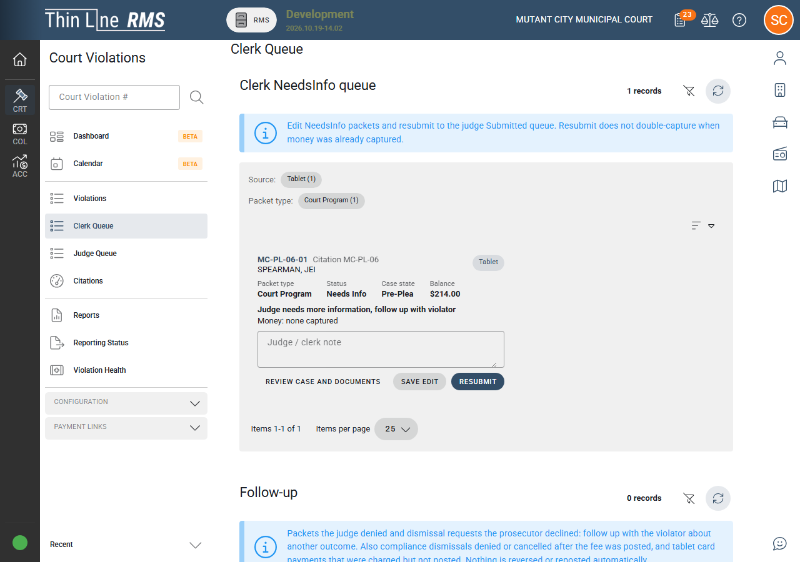
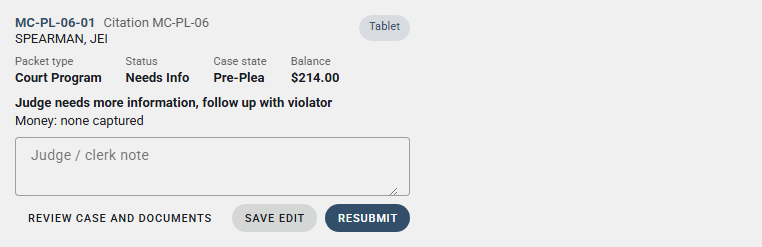
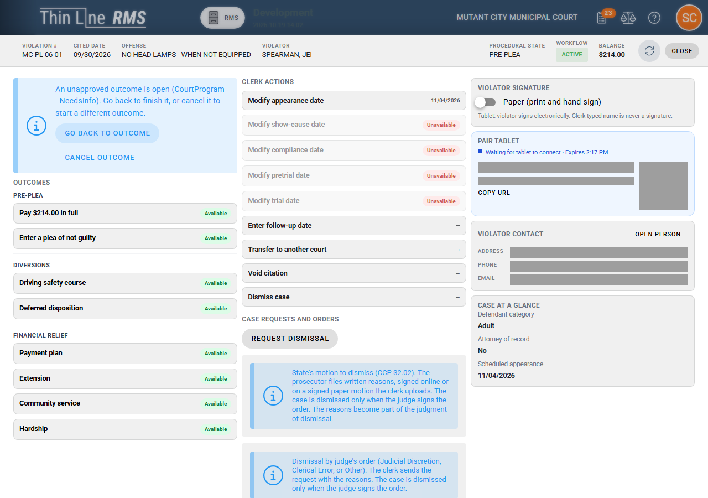

# Resolution workspace and form controls

> **Past demo ceiling:** This page describes behavior at pushed tip `6234e081ca`, which is **past** the official demo ceiling `64c4bd40a0`. It is **not** approved for demos until Court BA scores that tip PASS and the tls-* Playwright suite is re-run. See [Demoable now](demoable-now.md).

Court V2 **clerk resolution** work happens in the **Court Resolution** workspace (outcome cards, counter/tablet pairing, and judge-bound flows). This page covers workspace behavior and the shared **tls-*** form controls in the current Court V2 build.

## Payment Links → Online Portal

On a court violation, expand **Payment Links** in the left navigation:

| Link | Opens |
|------|--------|
| **Online Payment** | Public citation payment (`/public/payment/citation`) |
| **In-Person Payment** | Desk payment (`/public/payment/citation/desk`) |
| **Court V2 Online Portal** | Violator portal lookup (`/public/portal`) in a new tab |

Staff use **Court V2 Online Portal** to preview or assist with the same online paths defendants see after lookup.

*The online payment link opens the public citation payment flow in a new tab.*

*The in-person payment link opens the desk payment flow staff use at the counter.*

## tls-* controls (staff and portal)

Court and portal screens increasingly use Thin Line **tls-*** wrappers (for example `tls-text-field`, `tls-select`, `tls-date`, `tls-date-time`, `tls-checkbox`, `tls-numeric-input`, `tls-file-input`) instead of raw HTML inputs or legacy Vuetify fields. Behavior and validation should match the labeled control; test ids on critical flows are preserved for regression testing.

**Verification note:** Playwright end-to-end walks have **not** been re-run on the full tls-* control migration at tip `6234e081ca`. The official demo ceiling remains `64c4bd40a0` (see [Demoable now](demoable-now.md)).

## NEW intake: date of birth and speed

Before **Proceed to Pre-Plea**, the workspace enforces person data on the case:

| Requirement | When it applies |
|-------------|-----------------|
| **Date of birth** | Required on **NEW** intake before proceed; message: *Date of birth is required before Proceed to Pre-Plea*. Deferred eligibility for moving violations also uses the reference person DOB when age at offense is missing. |
| **Actual speed** and **posted speed limit** | Required on the **NEW** intake speed card when the offense mapping uses a speeding range. Copy: *Actual speed and posted speed limit are required for a speeding offense*. Missing values can block proceed and DSC-related checks tied to speed facts. |

Use the **NEW** intake panel on the resolution hub (desktop sidebar and mobile strip under the header).

*On a NEW case, the intake panel collects offense, appearance, fees, date of birth, and speed facts before proceed to pre-plea.*

*The outcomes hub lists violator options and clerk actions for a case ready for resolution work.*

## Enter a plea of not guilty

The dedicated **Enter a plea of not guilty** path replaces the generic enter-plea judge packet for not-guilty pleas:

| Channel | Behavior |
|---------|----------|
| **Clerk soft path** | Workflow enters **NOT GUILTY** and moves the case toward **PRE_TRIAL** without a judge outcome packet. |
| **Online** | Portal option **Enter a plea of not guilty** when `canEnterPleaOnline` allows; submission is **not** the same as a court-entered plea until staff process it. Portal copy: *Your not-guilty plea was submitted… Submission is not yet an entered plea.* |
| **Paper** | **Paper soft path for not guilty** — print the plea form, confirm hand signature, set **Pre-trial date**, then enter not guilty (no tablet pairing, no clerk typed-name signature, no judge packet). |

Guilty and no contest remain on other online options (pay in full, driving safety course, deferred disposition, and related packets).

## Counter tablet and NeedsInfo

- **Clerk ↔ tablet** pairing for outcome review is unchanged in purpose; see [Path walk](path-walk.md).
- When a judge returns **NeedsInfo** on hardship, community service, or similar outcome packets, the counter can **resubmit** after the defendant updates the tablet draft (staff APIs expose review context including the judge note).

*After pairing, the workspace shows **Tablet connected** so the clerk and violator can continue on the shared outcome path.*

*Packets returned with **Needs Info** appear in the Clerk Queue for follow-up.*

*The clerk can save edits and **Resubmit** after the violator updates the packet on the tablet.*

*The outcomes hub can show an unapproved outcome with **Go back** or **Cancel** while judge review is pending.*

## Hub refresh after cancel

If staff **Cancel** an unapproved outcome packet on the hub (for example a submitted pay-in-full that reversed tender), the outcome card grid **reloads** eligibility so muted paths (DSC, deferred, pay) reflect the restored balance.

## Related

- [Portal and online options](portal-and-online-options.md)
- [Court programs and eligibility](court-programs-eligibility.md)
- [Path walk](path-walk.md)
- [Compliance gaps (not full Texas statutory coverage)](compliance-gaps.md)
