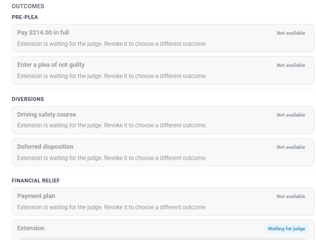
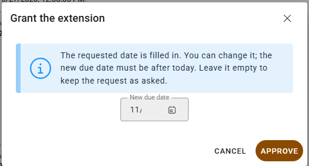

# Scenario: Extension (request for more time)

> **Not yet approved for demos.** This page describes the current Court V2 build, which is newer than the version approved for demos. Use it for training and planning. Check [Demoable now](../../demoable-now.md) before showing these screens to a customer.

## When to use

The violator needs more time to pay or to meet a deadline on the case.

For more time to finish a driving safety course, see [Driving safety course](driving-safety-course.md). That's a separate request.

## Who

- **Clerk** starts the request at the counter or records a paper ruling.
- **Violator** signs on the tablet, or requests it online where the court offers it.
- **Judge** decides every extension.

## One request, different labels

An extension is the same request wherever it starts:

| Where | Label |
|-------|-------|
| Clerk workspace | The **Extension** card in **Financial relief**, or **Request for more time** in **Case requests and orders** |
| Counter tablet | **Request for more time** |
| Portal | **Request an extension** |

## Rules

- A case can have only one open extension request.
- The violator can ask for a due date up to 30 days out.
- No evidence is required.
- Statutory compliance dismissal deadlines can't be extended.

## At the counter (tablet)

1. Open the case and select **Extension**, or **Request for more time**.
2. Pair the tablet. The violator gives the requested date, up to 30 days out, and signs.
3. Select **Submit for judge review**.
4. While the extension waits, the other outcome cards show **Not available** with *Extension is waiting for the judge. Revoke it to choose a different outcome.*

   

   *An extension waiting for the judge.*

## Online

Where the court offers it online, the violator uses **Request an extension** on the portal and picks a date up to 30 days out. The request goes to the judge.

## Judge

1. The judge opens the request in the Judge Queue and selects **Approve**.
2. The **Grant the extension** dialog opens with the requested date filled in. The judge can change it; the new due date must be after today. Leaving it empty keeps the request as asked.

   

   *The judge confirms or changes the new due date.*

3. Or the judge selects **Needs Info** or **Reject** with a note.

## Paper ruling

When the judge rules on paper, the clerk selects **Record judge's paper ruling** and enters the judge who ruled, the ruling, the dates, the new due date and any reasons.

## After approval

The case's due date changes to the date the judge set.

## Can't or blocked

- Clerks can't grant an extension. Each extension is a judicial ruling.
- Only one open extension per case, and only one open request of any kind.
- Extension and community service, and extension and hardship, aren't combined requests. These are "Known gap, not shipped".

## Related

- [Court programs and eligibility](../../court-programs-eligibility.md#request-for-more-time-extension)
- [Judge guide](../judge-guide.md#extensions-request-for-more-time)
