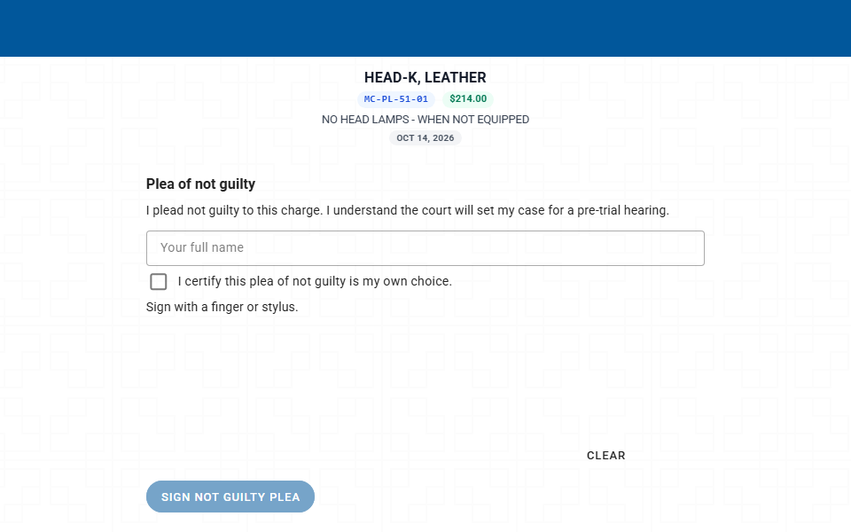

# Scenario: Not guilty

> **Not yet approved for demos.** This page describes the current Court V2 build, which is newer than the version approved for demos. Use it for training and planning. Check [Demoable now](../../demoable-now.md) before showing these screens to a customer.

## When to use

The violator wants to plead not guilty and have a pre-trial or trial setting.

## Who

- **Clerk** takes the plea at the counter or approves an online plea.
- **Violator** signs on the tablet or on paper, or submits online.
- **Judge** isn't involved in entering the plea. There's no judge request for a not guilty plea.

## At the counter (tablet)

1. Open the case and select **Enter a plea of not guilty** in **Pre-plea**.
2. Pair the tablet.
3. The violator types their name, certifies the plea is their own choice, signs, and selects **Sign not guilty plea**.

   

   *The violator signs the not guilty plea on the tablet.*

4. The tablet verifies the signature, and the plea is entered.

## On paper

1. Switch on **Paper (print and hand-sign)**.
2. Print the not guilty form and have the violator hand-sign it.
3. Mark it hand-signed. The plea is entered.

## Online

1. The violator chooses **Enter a plea of not guilty** on the portal, when the case allows it.
2. The portal tells them their submission isn't yet an entered plea.
3. The request lands in **Clerk Queue > Violator portal**.
4. The clerk selects **Review request**, then **Approve**. Only then is the plea entered.

There's no online guilty or no contest request on its own. Those pleas are part of other outcomes, such as pay in full, a driving safety course or deferred disposition.

## After the plea

- The case moves to pre-trial. The header shows the plea and the next setting.
- Pre-trial and trial dates drive the calendar from here. See [Calendar and appearances](../../../calendar-and-appearances.md).
- A plea also satisfies the scheduled appearance.
- If the violator later wants to pay in full instead, a pay in full approved by the judge replaces the not guilty plea (CCP 27.14(c)).

## Family-violence cases

Family-violence cases require the defendant to appear in court. A not guilty plea is taken at the counter or on paper only. Online, the portal explains that an in-person appearance is required (CCP 45A.151(d)).

## Can't or blocked

- Not available online for family-violence offenses.
- An online not guilty plea isn't entered until a clerk approves it.

## Related

- [Clerk guide](../clerk-guide.md#7-take-a-not-guilty-plea)
- [Portal and online options](../../portal-and-online-options.md)
