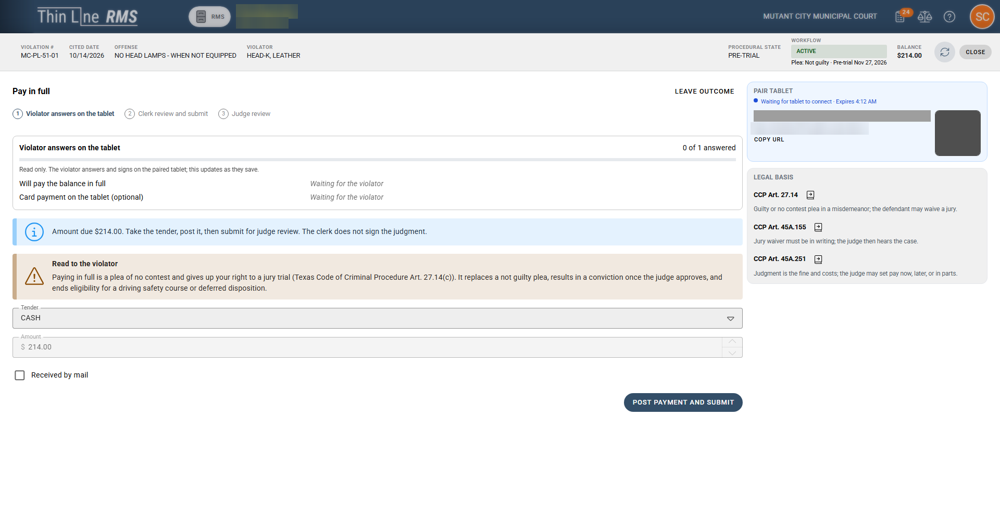

# Scenario: Plea and pay

> **Not yet approved for demos.** This page describes the current Court V2 build, which is newer than the version approved for demos. Use it for training and planning. Check [Demoable now](../../demoable-now.md) before showing these screens to a customer.

## When to use

The violator wants to resolve the case by paying: either the full amount now, or over time with a payment plan.

## Who

- **Clerk** runs the request at the counter and takes the payment (with the accounting role).
- **Violator** signs on the tablet, on paper, or uses the portal.
- **Judge** approves.

## Pay in full at the counter (tablet)

1. Open the case. In **Pre-plea**, select the pay in full card. It shows the amount, for example **Pay $214.00 in full**.

   

   *Pay in full opened at the counter.*

2. Pair the tablet. The violator reviews the documents, ticks **I have reviewed these documents**, and signs the plea and jury waiver.
3. Take the payment.
4. Select **Submit for judge review**. The money is held until the judge rules.
5. While the request waits, the other outcome cards are muted. To change course, revoke the request. See [Revoke a request](../clerk-guide.md#6-revoke-a-request-thats-waiting).

## Pay in full on paper

1. Switch on **Paper (print and hand-sign)** in **Violator signature**.
2. Print the forms and have the violator hand-sign them.
3. Mark the forms hand-signed, take the payment, and submit for the judge.
4. The judge checks the hand-signed paper when approving.

## Pay in full online

The violator looks up the citation and pays in full on the portal, except in these cases:

- **Family-violence offenses:** the card shows **Complete at counter**, and the violator must appear in person.
- **Minors:** pay in full isn't available online.

See [Portal requests](portal-requests.md).

## Judge

The request appears in the Judge Queue with the money held. The judge selects **Approve**, **Needs Info** or **Reject**.

## After approval

Approving enters a no contest plea, the jury waiver and the judgment. If a not guilty plea was on file, it's replaced (CCP 27.14(c)).

If the judge rejects the request, or the clerk or judge revokes it before the judge rules, the held money is refunded by check. Revoking enters no plea and doesn't change the case state.

## Payment plans

1. Select **Payment plan** in **Financial relief**.
2. A standard plan the judge has pre-authorized, taken at the counter or on paper, skips the ability-to-pay questions.
3. A claimed inability to pay, or a request for community service, a waiver or a non-standard plan, goes to the judge with the ability-to-pay details. See [Hardship and ability to pay](hardship-ability-to-pay.md).
4. Submit. When the judge approves, the judgment is signed and then the schedule starts. That approval is also the ability-to-pay finding.

Violators can also request a standard payment plan online. After the plan starts, missed payments follow the existing Missed payment work queue. See [Payment plans](../../../payment-plans.md).

## Can't or blocked

- Only one request can be open on the case. A second request can start after the judge decides the first, or after it's revoked or cancelled.
- Family-violence and minor cases can't pay in full online.
- A compliance dismissal is blocked once a payment has been entered as a plea and judgment.

## Related

- [Clerk guide](../clerk-guide.md)
- [Clerk workspace](../../resolution-workspace-and-controls.md)
