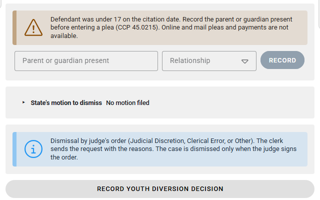

# Scenario: Youth and juvenile cases

> **Not yet approved for demos.** This page describes the current Court V2 build, which is newer than the version approved for demos. Use it for training and planning. Check [Demoable now](../../demoable-now.md) before showing these screens to a customer.

## When to use

The defendant was a minor on the offense date. This covers the parent presence rule, Youth Diversion, and dismissals for a parent's nonattendance.

## Who

- **Clerk** records the parent or guardian, runs Youth Diversion at the counter or on paper, and records paper objections.
- **Parent or guardian** is present and signs next to the child.
- **Prosecutor** can object to Youth Diversion.
- **Judge** decides and signs any hearing orders.

## Parent presence before a plea

When the defendant was under 17, the workspace shows: *Defendant was under 17… Record the parent or guardian present before entering a plea (CCP 45.0215). Online and mail pleas and payments are not available.*

1. In **Parent or guardian present**, enter the name and **Relationship**.
2. Select **Record**.
3. Pleas and outcomes can go ahead after that.

*A case for a child under 17, with the parent presence panel and Record youth diversion decision.*

## Youth Diversion

Youth Diversion is for children ages 10 to 16 on non-traffic, fine-only offenses. The card doesn't appear on traffic cases. It's handled at the counter or on paper only.

### At the counter (tablet)

1. Open the case and select **Youth Diversion** in **Diversions**.
2. Choose the conditions, such as community service, tobacco awareness or an alcohol class.
3. Pair the tablet. The child and the parent or guardian each sign.
4. Submit the request.

### On paper

1. Print the forms. The child and the parent or guardian both hand-sign.
2. Enter the parent's name, mark the forms hand-signed, and submit.

### Online

Youth Diversion isn't available online. The portal tells the violator: *Juvenile combined is not available online. Complete at counter.*

*The portal sends juvenile cases to the counter.*

### Prosecutor

The request appears in the prosecutor's **Youth diversion requests open for objection** list. The prosecutor can select **Object to youth diversion** with a note of up to 2,000 characters. If the prosecutor objects on paper, the clerk records the paper objection on the request. Youth Diversion isn't granted when the prosecutor objects (CCP 45A.504(d)).

### Decision

A clerk or the judge records the decision with **Record youth diversion decision**: declined, or not eligible (CCP 45A.504(b)). It's recorded on the case timeline with no e-signature. A prosecutor can't record it. Hearing orders are judge-only and need the judge's drawn signature.

## Parent nonattendance dismissal

A dismissal for a parent's part in a child's nonattendance (CCP 45A.403) is a judge-ordered dismissal.

1. Select **Request dismissal**, then **Judge-ordered dismissal**, and choose **Parent nonattendance (CCP 45A.403)**.
2. The school's proof is a clerk check on paper.
3. The judge signs the order of dismissal.

## Confidentiality

Youth Diversion records are visible to court staff only. Public lookup and payment pages don't show them.

## Can't or blocked

- No online or mail pleas or payments when parent presence is required.
- No Youth Diversion online.
- Youth Diversion and juvenile deferred disposition are separate outcomes. Driving safety course plans never apply to Youth Diversion.
- Some juvenile rules aren't supported yet. See [Compliance gaps](../../compliance-gaps.md).

## Related

- [Court programs and eligibility](../../court-programs-eligibility.md#youth-diversion)
- [Prosecutor guide](../prosecutor-guide.md#7-object-to-youth-diversion)
