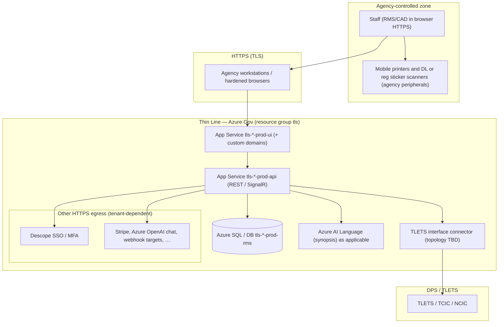
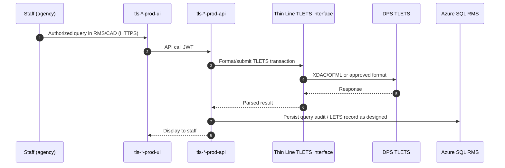

<!--
  THIN LINE SOFTWARE — Vendor draft (INTERNAL)
  Sections marked ⚠ REVIEW OR ⚠ DEPLOYMENT must be validated by product owners / CPSO / tenant config —
  automated text is inferred from the RMS repository and pipelines, NOT legal CPSO rulings.
-->

# Volume 03 — Architecture and data flow

> Moved from TLS-App `Docs/TLETS/attestation-kit/03-architecture-and-data-flow.md` on 2026-11-14. Links into the old TLS-App attestation kit or application packet no longer resolve.

**Attestation kit:** Volume 03  
**Document status:** Working draft — Slaton PD (pilot tenant)  
**Last revised:** 2026-07-20 _(direct TLETS interface application; Slaton PD pilot tenant)_  

**Submission tenant:** **Slaton Police Department**  

**Live Azure naming:** per-agency inventories under [`../agencies/`](../agencies/) — see tenant table below.

**Vendor Q&A round 2 (Q10–20, paused):** [`../correspondence/vendor-qna-round2-partial.md`](../correspondence/vendor-qna-round2-partial.md) · **round 3 (Q21–30):** [`../correspondence/vendor-qna-round3-partial.md`](../correspondence/vendor-qna-round3-partial.md)  

**Direct interface application:** [`../application/`](../application/)  

**Internal checklist:** [`../checklists/vendor-internal.md`](../checklists/vendor-internal.md) §7–§8 

### Active tenants (Jul 2026 concurrent rollout)

| Agency | Tenant key | Azure inventory |
|--------|------------|-----------------|
| Slaton PD | `slatontx` | [`../agencies/slaton-pd/azure-inventory.md`](../agencies/slaton-pd/azure-inventory.md) |
| Crosby County SO | `crosbytx` | [`../agencies/crosby-county-so/azure-inventory.md`](../agencies/crosby-county-so/azure-inventory.md) |
| Littlefield PD | `littlefieldtx` | [`../agencies/littlefield-pd/azure-inventory.md`](../agencies/littlefield-pd/azure-inventory.md) |
| Crystal City PD | `crystalcitypd` | [`../agencies/crystal-city-pd/azure-inventory.md`](../agencies/crystal-city-pd/azure-inventory.md) |
| Levelland PD | `levellandtx` | [`../agencies/levelland-pd/azure-inventory.md`](../agencies/levelland-pd/azure-inventory.md) |

**Pilot narrative below uses Slaton (`slatontx`)** — substitute ARM names from the agency inventory when exporting Vol 03 for other tenants.

---

Answers below are **first-pass fills** derived from codebase and deployment YAML (Azure Government, `.NET`/Vue stack, Descope JWT). Anything involving **agency CJIS gateways, hardware, DMPP, or CPSO questionnaires** requires **⚠ CPSO/agency verification**.

**Program scope:** This TLETS program is for **direct** in-app NCIC/TLETS queries (Thin Line as interface vendor). See [`../application/`](../application/). Update diagrams in this volume to show the **query path** (UI → Thin Line interface → DPS) before export; some Mermaid sketches below may still need connector topology filled in.

---

## Overview (one paragraph)

Thin Line RMS is a **multi-tenant records management system**. The **ThinLine.UI** client is **Vue 3 / Vuetify**, delivered as **static web assets** (`npm run build` → `dist/`) for **browser access**; **Thin Line does not ship or support an Electron/desktop-packaged RMS client** for this program. The primary **ThinLine.RMS.WebAPI** host runs **ASP.NET Core (.NET 10)** and exposes REST + **SignalR** hubs; JWT authentication is **`Microsoft.AspNetCore.Authentication.JwtBearer`** with authority from configuration (`Identity:Authority`).

Production deployment patterns in-repo target **Azure Government** subscribers. For each agency tenant, authoritative resource names live in **[`../agencies/{agency}/azure-inventory.md`](../agencies/)** (Slaton pilot example below uses **`slatontx`**).

**Thin Line RMS product narrative vs NCIC/III.** This program seeks approval for **authorized agency users to run TCIC/NCIC (TLETS) queries from within Thin Line RMS/CAD**, with Thin Line as the **interface vendor** ([`../application/DIRECT-INTERFACE-SCOPE.md`](../application/DIRECT-INTERFACE-SCOPE.md)). As of 2026-07, the monorepo’s `LetsQuery` feature is **recordkeeping**, not a complete wire client — diagrams and questionnaire answers must match **implementation + DPS TEST** reality. **⚠ CPSO**: confirm final narrative language against the Interface Questionnaire.

---

## Appendix — diagrams

Mermaid sources below can be pasted into **Visio / draw.io / Mermaid Live** for **“For Official Use Only”** PDFs. Canonical ARM names for **Slaton** (**`tls-slatontx-prod-*`**, **`tls-db2`**) — substitute per [`../agencies/`](../agencies/) for other tenants.

### A. Logical zones — Slaton PD vs Thin Line (Azure Government)

Depicts **agency-controlled** staff endpoints and **Thin Line–hosted** RMS in **Azure Government**, plus a **TLETS interface** path (placement TBD).

### B. Direct TLETS query — conceptual flow (target architecture)

Emphasizes **in-app** query initiation through Thin Line RMS/CAD and a Thin Line–operated interface path to TLETS. **Connector topology TBD** — replace placeholder once Azure vs agency placement is decided.

---

## §7.a — Cloud RMS access and TLETS interface

**Thin Line-hosted RMS path.** Yes — officers authenticate to RMS/CAD over HTTPS to Thin Line–managed Azure Gov workloads (exact pattern per lease/SOW).

**Thin Line as TLETS interface vendor.** This program proposes that Thin Line operate the **application interface** for TCIC/NCIC queries initiated from RMS/CAD. Message format, connector host, and access level are locked on the **TLETS Interface Questionnaire** ([`../application/tlets-interface-questionnaire.md`](../application/tlets-interface-questionnaire.md)).

**⚠ CPSO / engineering:** Do not claim live wire capability until DPS TEST succeeds and product ships the connector.

---

## §7.b — Dedicated interface server expectation

_No single server requirement appears in RMS application code._

**Typical architecture:** RMS API on **Azure App Service**–class compute; relational data in **Azure SQL** (government regions per pipeline); Redis optional for SignalR scale-out (see **`Program.cs`** SignalR Redis registration).

**PD site equipment (Slaton PD):** RMS **does not inherently require** a **new Thin Line-installed physical server** at the PD for **thin-client browser access**. Dedicated **agency CJIS gateways/workstations** remain **agency-owned** and satisfy controlled inquiry separation from RMS HTTPS. **⚠ VERIFY** with CPSO if any dated comment referenced a **agency-provisioned** versus **Thin Line-hosted** distinction.

---

## §7.c — Authentication and MFA

### Sign-in pathways

Thin Line RMS uses **`@descope/vue-sdk`** in the UI (**[`ThinLine.UI/src/main.ts`](../../../../ThinLine.UI/src/main.ts)**) and validates **JWT Bearer** tokens API-side (**[`ThinLine.API/ThinLine.RMS.WebAPI/Program.cs`](../../../../ThinLine.API/ThinLine.RMS.WebAPI/Program.cs)** `AddJwtBearer` with `RequireHttpsMetadata = true`; authority from **`Identity:Authority`**). **`DescopeIdentityService`** (**[`ThinLine.API/ThinLine.Business.Objects/Common/Authorization/DescopeIdentityService.cs`](../../../../ThinLine.API/ThinLine.Business.Objects/Common/Authorization/DescopeIdentityService.cs)**) performs Descope-backed identity provisioning.

Descope deployments commonly layer **FIDO/passkeys, OTP, SSO via SAML/OIDC** to upstream IdPs. **⚠ DOCUMENT (Slaton PD):** Enumerate federation (Descope-managed vs Microsoft/Google vs agency IdP) and MFA enforcement source (**Descope flow vs upstream IdP**) for assessors.

| Mechanism | Observed role in RMS codebase | MFA / credential owner |
|-----------|-------------------------------|---------------------------|
| Descope-hosted login + cookies | Primary UI bootstrap | Tenant-configured MFA in Descope / flows (**Slaton** config) |
| Local DB passwords / non-SSO | Not primary Thin Line-hosted pattern — **⚠ VERIFY** hybrid if any legacy | Applies only where used |

### RMS password posture

Agency SSO password rules / breach checks follow **agency IdP** + **Descope** configuration—not Windows SAM. CJIS CSP §IA-5 wording must cite **effective IdP**.

---

## §7.d — Mobile / MDM

**Client types:** RMS target is **responsive web** (Vue + Vuetify). **Thin Line does not distribute a supported desktop-packaged RMS installer** for Slaton PD—field use is **browser-based** only. [`vite-plugin-pwa`](../../../../ThinLine.UI/package.json) exists in the mono-repo; **⚠ DOCUMENT**: whether **Slaton PD** allows or blocks PWA installs for sworn users.

There is **no separate native RMS iOS/Android app** identified in-repo for CJIS payloads.

**MDM recommendation (draft wording only):** If users access RMS only through **agency-managed hardened browsers/devices** performing **HTTPS** sessions and **agency policy** restricts export/sync, RMS does not introduce parallel native storage akin to unmanaged mobile DB apps—but **agency AA** determines CJIS applicability. **⚠ CPSO.**

---

## §7.e — Indirect CJIS access (draft CPSO-aligned technical statement)

_Use **agency CJISO-directed** wording. Not legal determination._

Draft (requires CPSO edits):

> **Slaton Police Department** sworn users access Thin Line RMS/CAD over **HTTPS** from **agency-controlled browsers** to **Thin Line–managed Azure Government** application tiers—**Thin Line ships no RMS desktop installer** for this program. This TLETS application proposes **in-app TCIC/NCIC queries** via a Thin Line–operated interface (format and connector topology per Interface Questionnaire). CHRI/CJI in RMS remains role-gated; query authority remains the **agency ORI**.

⚠ Thin Line asserts **technical** segregation only—not **AA** applicability.

Mobile note: **⚠ DOCUMENT (Slaton PD)** — PWA use; CSP may still review **browser cache / screenshots / mobile browsers**.

---

## §7.f — TLS / cipher / FIPS posture

| Hop | Typical terminator _(⚠ TENANT EXPORT)_ |
|-----|----------------------------------------|
| User → RMS UI CDN / storage origin | HTTPS **TLS 1.2+** (**⚠ EXPORT** cipher list from Front Door/App Service/host) |
| UI → RMS API (`axios`) | HTTPS to API hostname |
| API → downstream (_SQL, Redis, Descope REST, Stripe, Azure OpenAI, etc._) | **TLS as enforced by SDK + dependency** (**⚠ CONFIG EXPORT**) |

**FIPS assertions:** Use Microsoft Azure FIPS 140 language. Microsoft states that FIPS 140 validation applies to **cryptographic modules**, not to a cloud service as a whole, and that cloud service providers can obtain and operate **FIPS 140 validated cryptographic modules** for the computing elements that comprise their cloud services. Microsoft also states that Azure services use **FIPS 140 approved algorithms** for data security. For this packet, pull **certificate inventory + Platform SSL policy** snapshots, Azure SQL TDE evidence, and any Key Vault / Managed HSM configuration for submission—not derivable statically from repo.

Do **not** represent Thin Line RMS or an Azure cloud service itself as FIPS 140 validated. If the audit asks for "FIPS mode" or FIPS validation, tie the evidence to the cryptographic module, Azure Government service configuration, TLS/certificate settings, Azure SQL TDE, and any customer-managed key/HSM configuration. Highlight the **September 21 2026** transition of FIPS 140‑2 validations to the CMVP historical list and coordinate any FIPS 140‑3 procurement/migration language with Azure Government guidance, Thin Line OPS/counsel, and DPS/CPSO.

---

## §7.g — Technical stack dossier _(repo snapshot 2026‑05‑12)_

Pinned versions originate from [`ThinLine.API/global.json`](../../../../ThinLine.API/global.json) (**SDK 10.0.100**), [`ThinLine.API/ThinLine.RMS.WebAPI/ThinLine.RMS.WebAPI.csproj`](../../../../ThinLine.API/ThinLine.RMS.WebAPI/ThinLine.RMS.WebAPI.csproj) (**`net10.0`**), [`ThinLine.API/Directory.Packages.props`](../../../../ThinLine.API/Directory.Packages.props), and [`ThinLine.UI/package.json`](../../../../ThinLine.UI/package.json). **⚠ REPLACE** deployed build hashes per release tagging.

### Application versions

| Component | Source | Repo-pinned approximation |
|-----------|--------|---------------------------|
| Runtime SDK | [`global.json`](../../../../ThinLine.API/global.json) | `10.0.100` (roll‑forward documented) |
| Web API TF | `.csproj` | `net10.0` |
| ASP.NET Core / EF packages | `Directory.Packages.props` | **`10.0.7`** (central versions) |
| Vue | [`package.json`](../../../../ThinLine.UI/package.json) | `^3.5.33` |
| Vite | [`package.json`](../../../../ThinLine.UI/package.json) | `^8.0.10` |
| TypeScript | [`package.json`](../../../../ThinLine.UI/package.json) | `^5.9.3` |
| Vuetify | [`package.json`](../../../../ThinLine.UI/package.json) | `3.12.3` |
| ESLint toolchain | [`package.json`](../../../../ThinLine.UI/package.json) | `^10.x` + Vue plugin |

### Change control (product engineering)

Describe using company SDLC—not stored canonically—**⚠ OPS PROVIDE**:

- Pull requests → code review (**Azure DevOps** PR flow implied via `.yml` pipelines)
- Releases via [`ThinLine.API/ThinLine.App.V5.Release.*.Pipeline.yml`](../../../../ThinLine.API/) tagging

### Hosted services / CJIS-scope dependencies _(⚠ TENANT DIFF)_ 

| Capability | Typical vendor/partner _(examples)_ | ⚠ NOTES |
|-----------|--------------------------------------|---------|
| Identity / SSO / MFA façade | Descope SaaS (**static.descope.com** allowed in RMS CSP [**`ThinLine.UI/public/web.config`**]) | ⚠ CPSO DPIA artifact |
| Payments | Stripe | PCI scope segregation |
| Cloud AI OCR / chat assistants | Azure OpenAI / Azure AI (**configured sections** in **`Program.cs`**) | **⚠ TENANT CJIS segregation** usage |
| Realtime scale-out | Redis (SignalR) | **⚠ TENANT GOV REGION** |

### Automated security scanning _(⚠ OPS enumerate CI)_ 

| Type | Repo evidence _(fill jobs)_ |
|------|--------------------------------|
| JS lint/test | ESLint Vitest npm scripts (**[`ThinLine.UI/package.json`](../../../../ThinLine.UI/package.json)**) |
| .NET compile-time analyzers | Default SDK analyzers + nullable (**⚠ ADD Sonar/other if used**) |
| E2E | Playwright (**[`ThinLine.UI/package.json`](../../../../ThinLine.UI/package.json)**) |

**SIEM ingestion for Thin Line RMS events:** **⚠ CORP SECURITY** furnish—**NOT** inferred from codebase.

---

## Open gaps requiring human confirmation

| # | Outstanding item | Blocking? |
|---|------------------|-----------|
| 1 | **Diagrams**: Mermaid in this document; export **PDF** (“For Official Use Only”, revision date, Slaton labeling) for submission | Medium |
| 2 | CPSO affirmation that **NCIC-non-termination** RMS narrative aligns with TL interface package | ✅ |
| 3 | Exported **cipher suite/FIPS diagnostics** PDF from production subscription (**Slaton** tenant) | ✅ |
| 4 | Slaton PD **SSO/MFA** workbook (Descope project config + upstream IdP) | Medium |
| 5 | **TLETS interface via Thin Line RMS/CAD**: **proposed** — see [`../application/`](../application/) | **⚠ CPSO + engineering** lock questionnaire + topology |

---

## Evidence pointers _(populate as artifacts exist)_

| Item | Relative path |
|------|---------------|
| **Per-agency Azure inventory** | [`../agencies/`](../agencies/) |
| **Slaton prod inventory + Q1–Q9 (pilot)** | [`../agencies/slaton-pd/azure-inventory.md`](../agencies/slaton-pd/azure-inventory.md) |
| Azure TLS policy screenshot | |
| CSP questionnaire PDF | |
