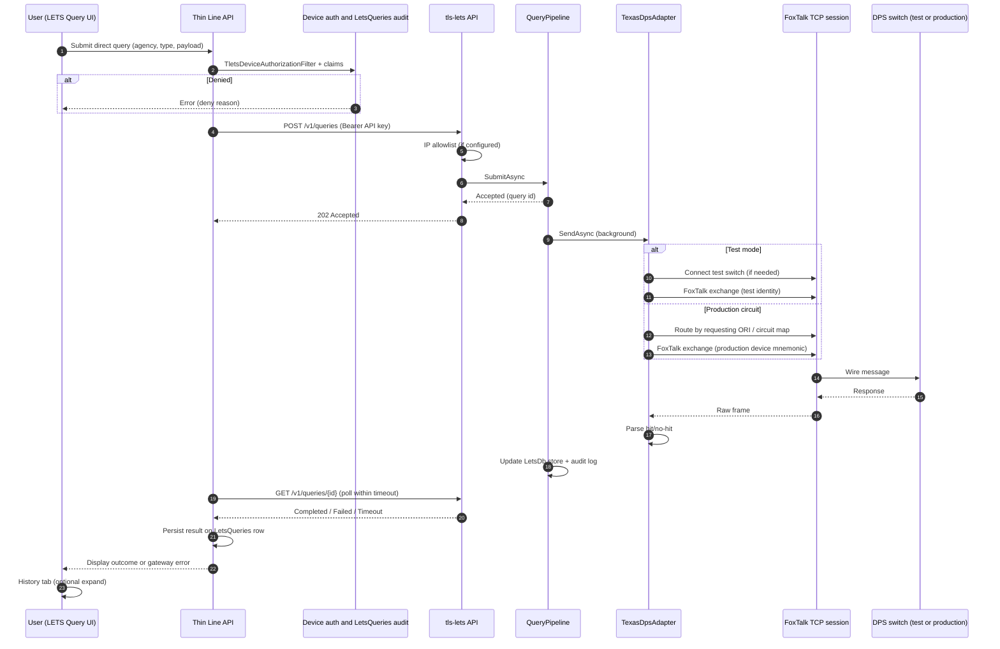

# End-to-end direct LETS query (internal)

**Status:** Working draft — **internal only**

This page traces a **direct LETS** query from the signed-in user in Thin Line through the gateway to Texas DPS and back to **History** in the LETS Query UI. Public steps: [Direct LETS queries](../../customer/cad/direct-lets-queries.md).

---

## Actors and systems

| Actor / system | Role |
|----------------|------|
| **User** | Dispatcher or officer on **LETS Query** (sandbox module): **Query**, **Devices**, **History** tabs |
| **Thin Line API** | `POST tlsapi/lets-queries/direct`, device filter, `LetsDirectQueryService`, `LetsGatewayClient`, `LetsQueries` audit rows |
| **tls-lets API** | `ThinLine.LETS.Api` on the gateway VM |
| **Texas Dps adapter** | FoxTalk TCP to DPS **test** or **production** switch |
| **DPS switch** | State message switch (TLETS) |

---

## Thin Line API path (before the gateway)

1. **Agency gate** — `Enable Direct LETS Queries` must be on (staff-only toggle). See [Direct LETS operations](direct-lets-operations.md).
2. **User claims** — `Lets.Tlets.Query` (and CHRI when applicable); support users bypass user-claim checks but not device verification.
3. **Device verification** — Active enrollment for the session; device status and row-level permissions; optional staff IP allowlist on agency TLETS settings.
4. **Validation** — `letsDirectQueryRules.ts` / server rules (DQ/RQ fields, query type, reason code).
5. **Gateway call** — `LetsGatewayClient` POST to configured `LetsGateway:BaseUrl` with API key and timeout. Unconfigured base URL → readiness failure without calling a placeholder host.
6. **Audit** — Every attempt writes a **LetsQueries** row (outcome, deny reason, device ids, correlation id, client IP).

On **deny** before or during gateway call, the UI shows the stored-response **error** field (human-readable **gateway failure reason** when the gateway or adapter returns one).

---

## Gateway path (tls-lets)

1. **POST /v1/queries** — Bearer key + optional IP allowlist.
2. **QueryPipeline** — Accept → background work.
3. **Adapter** — `TexasDpsAdapter` builds wire message, acquires send lock, sends/receives on `ITcpSession`.
4. **Parse** — Hit/no-hit and extracted fields → `GatewayResponse`.
5. **Store + audit** — Status updated; Serilog audit (and Service Bus if configured).

Client polls **GET /v1/queries/{id}** until terminal status (or Thin Line API abstracts polling into one synchronous user operation — product uses the combined **RunAsync** path with gateway timeout).

---

## Response back to the UI

1. Thin Line persists normalized query result linked to the attempt row.
2. **History** tab shows outcome; expandable detail uses internal helpers (`letsQueryHistoryDetails.ts`) — keep troubleshooting columns **internal** (do not document SecurityLog id lists or session-key format in `customer/`).
3. User sees success, hit/no-hit presentation, or **error** text from gateway/adapter/timeout.

---

## Test vs production switch

| Mode | Typical use |
|------|-------------|
| **Test switch** | DPS TEST bed; unencrypted FoxTalk; configured test ORI, device mnemonic, and user id |
| **Production circuits** | Per-ORI **terminal circuit** map; production device mnemonic on wire; may share TCP session machinery with test path per current adapter design |

Environment selection is **configuration on the gateway VM**, not a defendant-visible toggle. Wrong or missing circuit → connection failure, retry/backoff, and **Failed** status with message surfaced upstream.

---

## Timeouts and failures

| Failure | User-visible pattern |
|---------|----------------------|
| Gateway not configured | Readiness / immediate error without outbound call |
| API key / IP deny at gateway | 401/403 at gateway; API maps to failure reason |
| TCP connect failure | Logged; adapter may backoff (e.g. test switch retry window) |
| Receive timeout | **Timeout** status; error message in stored response |
| Max retries exceeded | **Failed** with adapter error text |
| Unsupported state code | **Failed** at pipeline (no adapter) |

Always log with correlation id for cross-system support.

---

## Sequence diagram (full round trip)

---

## Related

- [tls-lets gateway service](tls-lets-gateway.md)
- [Azure hosting and agency inventory](azure-hosting-and-agency-inventory.md)
- [Direct LETS operations](direct-lets-operations.md)
